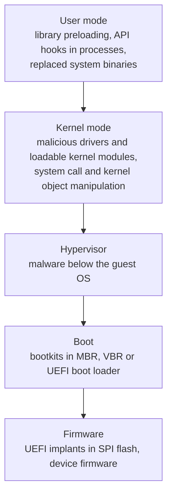

# Rootkit

## Summary

A rootkit is malicious software whose main job is to hide: it conceals itself and other malware, files, processes, network connections and registry keys from the user and from security tools, usually while keeping privileged access for the attacker. It does this by placing itself between the system and the tools that ask the system questions, then filtering the answers. Rootkits exist at several levels, from user-mode libraries through kernel drivers and modules to bootkits and firmware implants that start before the operating system. The deeper the level, the harder it is to detect from inside the running system, which is why the reliable defenses are prevention (Secure Boot, driver signing, least privilege, patching), measurement from outside (measured boot, offline scans, memory forensics) and rebuilding rather than cleaning compromised hosts.

## Prerequisites

- [Malware](../malware.md): classification and the general lifecycle of an infection.
- [Privilege escalation](../../attack-lifecycle/privilege-escalation.md): most rootkits need administrator or kernel privileges first.
- Basic operating system concepts: user mode and kernel mode, system calls, drivers and kernel modules, the boot process.

## Core concepts

### Definition

NIST SP 800-83 Rev. 1 (2013) defines a rootkit as "a collection of files that is installed on a host to alter its standard functionality in a malicious and stealthy way", and notes that it "typically makes many changes to a host to hide the rootkit's existence, making it very difficult to determine that the rootkit is present and to identify what the rootkit has changed". NIST classifies rootkits as *attacker tools*: they have no infection capability of their own and are installed by other malware or by an attacker who already has access.

MITRE ATT&CK (Enterprise v20.1, November 2026) T1014 Rootkit: "Rootkits are programs that hide the existence of malware by intercepting/hooking and modifying operating system API calls that supply system information." Related techniques: T1542.003 Bootkit, T1542.001 System Firmware and T1547.006 Kernel Modules and Extensions.

The name comes from Unix, where `root` is the administrator account and a "kit" was a set of replaced system tools that kept root access hidden.

### Analogy

Imagine a building whose security office watches the corridors only through a camera system. A burglar who controls the video switch can loop old footage for the corridor he is in. Every guard looks at the screens, sees empty corridors, and concludes that nobody is there. The cameras work, the guards are attentive, but their only view of reality passes through the burglar's hands.

The analogy maps the cameras to system APIs and the guards to security tools. It explains why the defense is an independent view (a second camera system, a guard walking the corridor). It breaks in one way: in the deepest rootkits the burglar can also alter the second camera system if it is wired through the same switch, which is why the independent view must come from outside the compromised system, not just from another tool on it.

### Levels



Each step down the diagram runs earlier or with more privilege than the one above, so it can lie to everything above it and survive more remediation steps.

| Level | Where it lives | Survives | Detection from the running OS |
| --- | --- | --- | --- |
| User mode | Shared libraries loaded into processes, modified binaries | Reboot (with persistence), not OS reinstall | Feasible: file integrity, cross-view, preload checks |
| Kernel mode | Drivers (Windows), loadable kernel modules (Linux), kernel extensions | Reboot, not OS reinstall | Unreliable: the kernel answers every question |
| Bootkit | MBR, VBR, UEFI boot loader | OS reinstall if the boot area is not rewritten | Very hard: loads before the OS and its security tools |
| Firmware | UEFI firmware in SPI flash, device firmware | Disk replacement and OS reinstall | Practically impossible from the OS. Needs firmware measurement or reflashing |

ATT&CK's bootkit entry explains the core problem of the lower levels: bootkits reside "at a layer below the operating system and may make it difficult to perform full remediation unless an organization suspects one was used".

### How hiding works

The common mechanism is *interception*: the rootkit gets between a question and its answer and filters the answer.

- **Library preloading (user mode, Linux).** The dynamic linker loads libraries listed in `/etc/ld.so.preload` or the `LD_PRELOAD` variable before others, so their functions take precedence. A malicious library can filter what `readdir` or similar functions return to every program that uses them.
- **API hooking (user mode, Windows).** Modifying function entry points or import tables inside processes.
- **System call and kernel object manipulation (kernel mode).** A malicious module or driver changes how the kernel answers system calls, or unlinks a process from the kernel's process list (*direct kernel object manipulation*), so it no longer appears in listings.
- **Boot interception (bootkit).** Code in the boot path patches the operating system loader or kernel in memory while it starts, before integrity checks run.

Defenders exploit a weakness that all of these share: a rootkit filters a particular *view*. If two independent views of the same fact disagree, something is filtering one of them. That is *cross-view detection*.

### Defenses that change the outcome

| Control | Against | Notes |
| --- | --- | --- |
| Least privilege, patching | All levels, because most need admin or kernel privileges first | The cheapest and most effective step |
| Secure Boot and boot loader signing | Bootkits | Only if the platform keys are under control. A system in UEFI "setup mode" (as on the machine used below) does not enforce it |
| Kernel module and driver signing, Windows vulnerable driver blocklist, HVCI | Kernel rootkits | Attackers abuse signed vulnerable drivers ("bring your own vulnerable driver"), so blocklists matter |
| Measured boot with TPM and remote attestation | Bootkits, some firmware | Compares measurements with known good values from outside the host |
| EDR with kernel telemetry | User mode and some kernel rootkits | A kernel rootkit can blind it |
| Memory forensics on an acquired image | Kernel rootkits | Analysis runs on another machine, so the rootkit cannot filter it |
| Offline scan (boot from trusted media) | User and kernel rootkits on disk | Does not see firmware |
| Rebuild from known good media, reflash firmware | All levels | The only remediation with high confidence |

## Worked example

The script [scripts/check-rootkit-indicators.py](scripts/check-rootkit-indicators.py) (Python 3.10, standard library only, read-only) runs four checks on a Linux host. It hides nothing and changes nothing. It compares independent views and looks for preload configuration:

1. **Kernel taint.** `/proc/sys/kernel/tainted` is non-zero when, among other things, unsigned or out-of-tree modules were loaded.
2. **Module cross-view.** Loadable modules have a directory in `/sys/module` with an `initstate` file and a line in `/proc/modules`. A module that appears in one view but not the other is a classic sign of a module that hides itself from one list.
3. **PID cross-view.** For each PID, the script asks the kernel whether the process exists with `kill(pid, 0)` (signal 0 sends nothing) and compares with the `/proc` directory listing. A process that answers but is not listed is hidden from the listing. Threads answer `kill()` too, so the script ignores them.
4. **Preload indicators.** A non-empty `/etc/ld.so.preload`, and processes with `LD_PRELOAD` in their environment.

Run on Ubuntu 22.04 with kernel 6.8.0-138-generic, as a normal user, November 2026:

```bash
python3 check-rootkit-indicators.py
```

Output:

```text
kernel taint value: 0
modules in /sys/module but not /proc/modules: none
modules in /proc/modules but not /sys/module: none
PIDs alive but not listed in /proc (first 65535 checked): none
preload indicators: ['PID 3351 has LD_PRELOAD in its environment', 'PID 3831 has LD_PRELOAD in its environment', 'PID 3905 has LD_PRELOAD in its environment']
```

The preload hits need triage, not panic:

```bash
for p in 3351 3831 3905; do
  echo "$p $(cat /proc/$p/comm) $(tr '\0' '\n' < /proc/$p/environ | grep ^LD_PRELOAD)"
done
```

```text
3351 snap-store LD_PRELOAD=:/snap/snap-store/1216/gnome-platform/$LIB/bindtextdomain.so
3831 user-session-he LD_PRELOAD=:/snap/snapd-desktop-integration/391/gnome-platform/$LIB/bindtextdomain.so
3905 snapd-desktop-i LD_PRELOAD=:/snap/snapd-desktop-integration/391/gnome-platform/$LIB/bindtextdomain.so
```

All three are Snap desktop packages that preload a translation helper from their own read-only, signed Snap mount. That is a known legitimate use. A suspicious hit would be a library in `/tmp`, `/dev/shm`, a hidden directory or a path not owned by any package, loaded into many unrelated processes.

What the clean result means: on this host, nothing filters these four views *in a way these checks can see*. It does not prove the host is clean. A kernel rootkit that filters both `/proc` and `/sys` consistently, or that answers `kill()` falsely, defeats the script. The checks are cheap triage. Assurance comes from memory forensics on an image analyzed elsewhere, offline disk scans and boot measurements. The same machine also reported `SecureBoot disabled` and `Platform is in Setup Mode` from `mokutil --sb-state`, which means boot-level protections are not enforced on it, a finding in its own right.

## Trade offs and when to use it

| Approach | Strength | Cost and limits |
| --- | --- | --- |
| On-host cross-view checks (as above), `chkrootkit`, `rkhunter` | Cheap, fast triage at scale | Defeated by competent kernel rootkits, produce false positives |
| EDR | Continuous, catches many user-mode techniques and known drivers | Can be blinded or unloaded by kernel-level malware |
| Memory forensics (for example Volatility on an acquired image) | Strong against kernel rootkits | Needs acquisition tooling, skills and time per host |
| Offline scanning from trusted media | Bypasses on-host filtering | Downtime, does not see firmware |
| Measured boot and attestation | Detects boot chain changes remotely | Requires TPM, attestation infrastructure and known good baselines |
| Rebuild and reflash | Highest confidence | Downtime, effort, data recovery |

Decision rule from incident response practice: if a kernel rootkit or bootkit is suspected on a host, do not try to clean it. Collect evidence (memory image, disk image), then rebuild from known good media and, for bootkits or firmware implants, reflash or replace firmware and rotate every credential the host could see. NIST SP 800-83 Rev. 1, section 4.4 (Eradication), says the same: when a host "has had backdoors, rootkits, or other damaging attacker tools installed", rebuilding it "would be the most reliable way of restoring its integrity", and it lists "System files were replaced by a Trojan horse, backdoor, rootkit, attacker tools, or other means" among the characteristics that call for a rebuild instead of disinfection.

## Common mistakes

- **Trusting a clean scan from the infected system.** Fix: verify from outside (memory image, offline scan, attestation).
- **Cleaning instead of rebuilding.** Fix: rebuild hosts with confirmed kernel, boot or firmware compromise.
- **Treating every `LD_PRELOAD` as malicious, or ignoring them all.** Fix: baseline legitimate uses (as with the Snap packages) and alert on new paths.
- **Leaving Secure Boot off or in setup mode.** Fix: enable it, manage keys, monitor for changes.
- **Allowing any signed driver.** Fix: enable the vulnerable driver blocklist and HVCI on Windows, and module signature enforcement on Linux where practical.
- **Forgetting credentials.** A rootkit has seen everything. Fix: rotate passwords, keys and tokens used on the host.

## Detection and mitigation

**Detection.**

- Cross-view differences: processes, files, modules, network connections and registry keys seen through two independent methods.
- Kernel and driver events: new driver or module loads (Windows Sysmon event ID 6 "Driver loaded", Linux audit rules on `init_module` and `finit_module` system calls), kernel taint changes.
- Boot integrity: Secure Boot state changes, measured boot attestation failures, unexpected boot loader hashes.
- Memory forensics: hidden processes, unlinked kernel objects, hooked system call tables.
- Network: traffic from a host that its own tools do not attribute to any process.

**Mitigation.**

- Least privilege and patching to prevent the privilege the rootkit needs.
- Secure Boot, signed boot loaders, module and driver signing, vulnerable driver blocklists.
- Integrity monitoring of system binaries and boot components.
- Rebuild and credential rotation after confirmed compromise.

## Practice

1. Why does NIST call a rootkit an attacker tool rather than malware in the strict sense?
2. What is cross-view detection, and why can a kernel rootkit defeat it on the same host?
3. Rank user-mode, kernel, bootkit and firmware rootkits by how hard they are to remove, and explain why.
4. In the worked example, why were the three `LD_PRELOAD` hits judged benign?
5. Name two controls that prevent bootkits.

Answers:

1. It has no infection capability of its own. It is installed by other malware or by an attacker who already has access.
2. Comparing two independent views of the same fact; a difference means one view is filtered. A kernel rootkit controls the kernel that answers both questions, so it can make both views agree.
3. User mode (easiest) < kernel < bootkit < firmware (hardest), because each lower level runs earlier or with more privilege and survives more remediation steps (reboot, OS reinstall, disk replacement).
4. They preload a known helper library from read-only, signed Snap package paths owned by the processes' own packages.
5. Secure Boot with signed boot loaders, and measured boot with TPM attestation. Least privilege also helps, because writing the boot area needs administrator rights.

## Further reading

- [NIST SP 800-83 Rev. 1, Guide to Malware Incident Prevention and Handling for Desktops and Laptops (2013)](https://doi.org/10.6028/NIST.SP.800-83r1): rootkit definition, attacker tools and rebuild guidance. Checked 2026-11.
- [MITRE ATT&CK T1014 Rootkit](https://attack.mitre.org/techniques/T1014/), [T1542.003 Bootkit](https://attack.mitre.org/techniques/T1542/003/) and [T1547.006 Kernel Modules and Extensions](https://attack.mitre.org/techniques/T1547/006/): technique descriptions (Enterprise v20.1 STIX data, checked 2026-11).
- [Linux kernel documentation, Tainted kernels](https://docs.kernel.org/admin-guide/tainted-kernels.html): meaning of each taint bit used by the script.
- [Microsoft, recommended driver block rules](https://learn.microsoft.com/en-us/windows/security/application-security/application-control/app-control-for-business/design/microsoft-recommended-driver-block-rules): the vulnerable driver blocklist.
- Related notes: [malware](../malware.md), [fileless malware](../fileless-malware/README.md), [dropper](../dropper.md), [intrusion detection systems](../../../defensive-operations/detection/ids/README.md).
