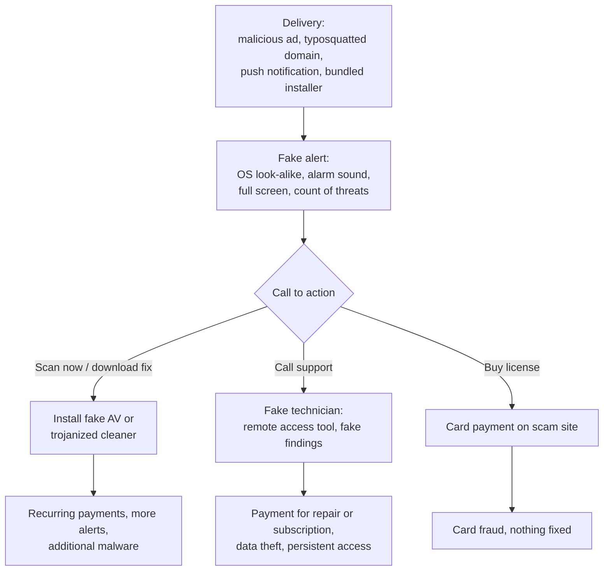

# Scareware

## Summary

Scareware is software or web content that frightens people with false or exaggerated warnings, usually that their computer is infected or broken, so that they pay for a useless "fix", install malware, call a fake support line or hand over remote access. Typical forms are fake antivirus programs (Microsoft calls them *rogue security software*), pop-ups in the browser that imitate operating system alerts, and "PC optimizer" tools whose scans always find serious problems. The harm is fraud, malware installation and, through remote access, full compromise of the device. It is fought with browser and endpoint protection, by blocking the delivery channels (malicious ads, push notifications), by consumer protection enforcement, and by teaching one simple rule: real security tools do not ask you to call a phone number or pay to remove a threat they just found.

## Prerequisites

- [Malware](malware.md) and [potentially unwanted application](potentially-unwanted-application.md), the category for misleading but not clearly malicious software.
- [Psychology of cyberattacks](../../../security-and-risk-management/security-awareness/social-engineering/psychology-of-cyberattacks.md): fear and urgency.
- [Drive-by attacks](../web-attacks/drive-by-attack.md) and malicious advertising, common delivery routes.

## Core concepts

### Definition

*Scareware* combines a technical delivery mechanism with social engineering based on fear. Microsoft's classification (Microsoft Defender XDR documentation, checked 2026-11) contains two relevant categories:

- **Rogue security software** (malware): "Malware that pretends to be security software but doesn't provide any protection. This type of malware usually displays alerts about nonexistent threats on your device. It also tries to convince you to pay for its services."
- **Unwanted software, lack of choice**: software that "Display[s] exaggerated claims about your device's health", "Make[s] misleading or inaccurate claims about files, registry entries, or other items on your device" or "Display[s] claims in an alarming manner about your device's health and require[s] payment or certain actions in exchange for fixing the purported problems."

So scareware ranges from outright malware to deceptive software that is legal to sell in some places but is still detected as unwanted. Browser-based scareware often involves no installed software at all: the "alert" is a web page.

| Form | Installed software | Goal | Typical classification |
| --- | --- | --- | --- |
| Fake antivirus (rogue security software) | Yes | Payment, further malware | Malware |
| Fake system optimizer or cleaner | Yes | Payment for a "full version" | Unwanted software or PUA |
| Browser tech support scam page | No | Phone call, remote access, payment | Malicious website, fraud |
| Push notification scareware | No (browser permission) | Clicks to fake scanners or scams | Malicious website, abuse of browser feature |
| Mobile "your phone is infected" pop-ups | Usually no | Install a malicious or useless app, subscription | Malicious ads, PUA |

### Analogy

A man in a garage uniform stops you in a car park, points under your car and says the brake line is leaking, it is dangerous to drive, but he can fix it right now for 200 euros. There is nothing wrong with your brakes. You pay because the claim is frightening, specific and urgent, and because the uniform suggests expertise.

The analogy fits the business model (sell a fix for an invented problem) and the levers (fear, urgency, authority). It breaks in one way: the fake mechanic cannot follow you home, while scareware that you install, or a "technician" you let in with remote access, stays on the device and can steal data or install more malware.

### Mechanism



The diagram shows three monetization paths after the same fake alert. The phone path overlaps with [quid pro quo](../../../security-and-risk-management/security-awareness/social-engineering/quid-pro-quo.md) social engineering: the "technician" offers help in exchange for remote access and money.

### Psychological levers

- **Fear of loss**: data, money, identity.
- **Authority**: logos and wording copied from Microsoft, Apple or antivirus vendors.
- **Urgency**: countdowns, "do not close this window", "do not restart".
- **Specificity**: an exact number of threats and file names makes the claim sound measured.
- **Sensory pressure**: alarm sounds, full-screen mode, pages that resist closing.

### A real enforcement case

In March 2024 the US Federal Trade Commission announced that the Cyprus-based companies Restoro and Reimage agreed to pay 26 million US dollars to settle charges. According to the FTC, since at least January 2018 they used pop-ups imitating Microsoft Windows warnings to scare people into running scans, the scans reported serious problems "regardless of the actual health of the consumers' computers", and telemarketers then sold technician services costing hundreds of dollars more than the software. FTC investigators made test purchases from a computer with no security or performance problems. The companies did not admit wrongdoing. In March 2025 the FTC sent refunds totaling over 25.5 million dollars. (Details from the FTC press release summary and press coverage; I did not read the court order.)

## Worked example

A security team scans the HTML of pages that users visited after reporting "a virus warning" to the help desk. A simple scoring function looks for scareware traits. The pages are synthetic, and the phone number uses the reserved fictional range 555-0100 to 555-0199.

```python
# Python 3.10, standard library only. Synthetic page snippets.
import re

RULES = [
    (r"(virus|trojan|spyware|malware)[^.<]{0,40}(detected|found|infected)", 3, "infection claim"),
    (r"\b\d{1,3}\s+(threats|viruses|infections)\b", 2, "precise threat count"),
    (r"(call|contact)[^<]{0,40}(\+?1[\s-]?)?\(?\d{3}\)?[\s-]\d{3}[\s-]\d{4}", 4, "support phone number"),
    (r"requestFullscreen|webkitRequestFullscreen", 3, "forces full screen"),
    (r"onbeforeunload|beforeunload", 2, "blocks leaving the page"),
    (r"<audio[^>]+autoplay|new Audio\(", 2, "plays alarm audio"),
    (r"(windows|microsoft|apple)\s+(defender|security|support)", 2, "brand impersonation"),
    (r"(do not|don't)\s+(close|restart|shut)", 2, "urgency: do not close"),
    (r"(buy|purchase|activate)\s+(now|license|protection)", 2, "sales prompt"),
]

def score(html: str):
    s, why = 0, []
    for rx, w, label in RULES:
        if re.search(rx, html, re.I):
            s += w
            why.append(label)
    return s, why

pages = {
  "news article about malware": "<h1>New trojan detected in app stores</h1><p>Researchers found 12 apps...</p>",
  "fake Windows alert": """<audio src=alarm.mp3 autoplay></audio><h1>Windows Defender Security</h1>
     <p>Trojan Spyware detected! 5 threats found. Do not close this window.</p>
     <p>Call Microsoft Support +1 555-010-0199</p>
     <script>document.documentElement.requestFullscreen(); window.onbeforeunload = () => 'Are you sure?';</script>""",
  "fake cleaner download page": "<p>Your PC is infected: 23 viruses found. Scan complete.</p><a>Buy now and activate protection</a>",
  "real vendor product page": "<h1>Endpoint protection</h1><p>Trial available. Contact sales.</p>",
}
for name, html in pages.items():
    s, why = score(html)
    print(f"{s:2d}  {name:<28} {'; '.join(why) or '-'}")
```

Output:

```text
 3  news article about malware   infection claim
20  fake Windows alert           infection claim; precise threat count; support phone number; forces full screen; blocks leaving the page; plays alarm audio; brand impersonation; urgency: do not close
 7  fake cleaner download page   infection claim; precise threat count; sales prompt
 0  real vendor product page     -
```

No single trait is decisive: a news article about malware matches "infection claim" too. The combination is what separates scareware: a fake alert stacks fear, authority, urgency and a call to action, and adds browser tricks (full screen, alarm audio, blocking navigation). A threshold of about 6 in this toy scoring flags both scam pages and leaves the legitimate ones. The output feeds a proxy block list, and the users who saw the "fake Windows alert" page are asked whether they called the number, because a call often means a remote access session took place.

## Trade offs and when to use it

| Control | Benefit | Cost and limits |
| --- | --- | --- |
| Browser protection (SmartScreen, Safe Browsing) and DNS filtering | Blocks known scam domains | New domains appear daily |
| Ad blocking or restrictive ad policies on corporate browsers | Removes the main delivery channel | Some sites break, policy discussion with business |
| Browser policy to block notification permission prompts | Stops push notification scareware | Some legitimate web apps lose notifications |
| PUA protection in endpoint security | Blocks fake cleaners and optimizers | Audit mode first to avoid disrupting legitimate tools |
| Application control | Fake antivirus cannot install | Policy maintenance |
| Remote access tool allow-listing | Stops the phone-based path from becoming a compromise | Must include built-in tools |
| Awareness: "real alerts never contain phone numbers" | Covers all forms | Fear works on trained people too, keep the rule simple |
| Consumer protection enforcement | Removes operators and returns money | Slow, cross-border |

## Common mistakes

- **Treating a scareware pop-up as harmless because nothing was installed.** The user may have called the number and allowed remote access. Fix: always ask what the user did after seeing the alert.
- **Users not knowing how to escape a page that blocks closing.** Fix: teach them to close the browser with the task manager (or force quit) and report it, never call or pay.
- **Allowing any "optimizer" software.** Fix: enable PUA protection and maintain an approved software catalog.
- **Ignoring browser notification permissions.** Fix: review and revoke site notification permissions, and control them by policy.
- **Calling every alarming page scareware.** Some warnings are real, for example a browser's own Safe Browsing interstitial. Fix: teach what real warnings look like (inside the browser or security product, never with a phone number).

## Detection and mitigation

**Detection.**

- Proxy and DNS logs: visits to newly registered or known tech support scam domains, often after an ad click.
- Help desk tickets about "virus warnings" or "Microsoft called me".
- Endpoint: installation of fake antivirus or cleaner software (PUA or malware detections), remote access tools started right after a browser session with a scam page.
- Browser telemetry: full-screen requests and notification permission grants on unknown sites.

**Mitigation.**

- Browser protection, DNS filtering, ad and notification policies.
- PUA protection and application control.
- Remote access tool allow-listing and monitoring.
- Incident response for users who called: end remote sessions, scan or rebuild the device, reset credentials used on it, and help the user dispute card payments.
- Report scam domains and phone numbers to the browser vendor, hosting provider and, in the US, the FTC.

## Practice

1. What does Microsoft call fake antivirus software, and how does it classify misleading "health" claims by other software?
2. Why can browser-based scareware be dangerous even though no software is installed?
3. Which three psychological levers does a typical fake alert combine?
4. In the worked example, why did the news article score 3 but was not flagged?
5. What one rule would you teach users about security alerts?

Answers:

1. Rogue security software (malware). Software that makes exaggerated or alarming claims about device health and demands payment is classified as unwanted software under "lack of choice".
2. It can lead the user to call a fake support line and grant remote access, install malware or pay a scammer.
3. Any three of fear, authority, urgency, specificity and sensory pressure.
4. It matched only one trait (an infection claim). Scareware stacks several traits, so the threshold requires a combination.
5. Real security tools never ask you to call a phone number or pay to remove a threat they just found.

## Further reading

- [Microsoft, How Microsoft identifies malware and potentially unwanted applications](https://learn.microsoft.com/en-us/defender-xdr/criteria): rogue security software and the "lack of choice" criteria. Vendor source. Checked 2026-11.
- [US FTC, "Tech Support Firms Will Pay $26 Million to Settle FTC Charges That They Deceived Consumers into Buying Repair Services", March 2024](https://www.ftc.gov/news-events/news/press-releases/2024/03/tech-support-firms-will-pay-26-million-settle-ftc-charges-they-deceived-consumers-buying-repair): the Restoro and Reimage case. Checked 2026-11 through the press release summary.
- [Microsoft, Block potentially unwanted applications with Microsoft Defender Antivirus](https://learn.microsoft.com/en-us/defender-endpoint/detect-block-potentially-unwanted-apps-microsoft-defender-antivirus): blocking fake cleaners and related software.
- Related notes: [potentially unwanted application](potentially-unwanted-application.md), [quid pro quo](../../../security-and-risk-management/security-awareness/social-engineering/quid-pro-quo.md), [drive-by attack](../web-attacks/drive-by-attack.md), [typosquatting](../web-attacks/typosquatting.md).
