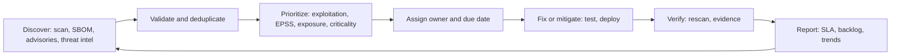

# Vulnerability remediation

## Summary

Vulnerability remediation is the part of vulnerability management where a known weakness is actually removed or made harmless: patched, reconfigured, isolated, compensated for or formally accepted. Finding vulnerabilities is cheap, and fixing them is the bottleneck, so the quality of a program is the quality of its prioritization, its ownership and its time to fix. CVSS severity alone ranks the queue badly. Evidence of exploitation (the CISA Known Exploited Vulnerabilities catalog), the probability of exploitation (EPSS), exposure of the asset and its business role give a better order. This note covers the remediation options, the prioritization inputs, service levels and exceptions, the verification step that is often skipped, and a tested script that compares a CVSS-only queue with a risk-based one.

## Prerequisites

- [CVE](../cve.md), [NVD](../nvd.md) and [CVSS](../cvss.md), the identifiers and scores used throughout.
- [CWE](../cwe.md) for the weakness classes behind recurring findings.
- [Attack vectors](../../threats-and-attacks/attack-vectors/README.md), for reachability.
- [Asset management](../../../asset-security/asset-management/README.md), because remediation needs to know who owns the asset.
- [Zero-day attacks](../zero-day-attack.md) for the case where no patch exists.

## Core concepts

### Definition

*Remediation* in this note means any action that eliminates a vulnerability or removes its exploitability on a specific asset. NIST SP 800-40 Rev. 4 (*Guide to Enterprise Patch Management Planning: Preventive Maintenance for Technology*, April 2022, supersedes Rev. 3 of July 2013) describes enterprise patch management as the cycle of identifying, prioritizing, acquiring, installing and verifying updates across an organization, and treats patching as preventive maintenance, a routine cost of doing business and not an optional expense. It also notes that business owners and security or technology managers often disagree about the value of patching, and it recommends an enterprise strategy to make patching simpler and more consistent. (Checked on the NIST page, 2026-10; I read the abstract and not the full PDF.)

Four terms need separating:

| Term | Meaning |
| --- | --- |
| Vulnerability scanning | Detects vulnerable software and configurations. It is an input. |
| Patching | Installing a vendor update. One remediation method. |
| Remediation | Any action that removes or neutralizes the vulnerability, with verification. |
| Mitigation | Reduces likelihood or impact without removing the flaw. A temporary or compensating control. |

### Analogy

An emergency department triage nurse. Many patients arrive, and the nurse orders them by danger and by what can be treated now, not by the first letter of the surname. A scanner that lists 40,000 findings sorted by CVSS is a waiting room sorted by a single vital sign. The analogy breaks because patients cannot be "accepted risk": in security, some findings are knowingly left open with a documented owner and an expiry, and that is a legitimate outcome.

### Why prioritization decides the outcome

The number of published vulnerabilities is larger than any team can fix in the same period, and only a small share are exploited. Remediation capacity is therefore a budget to spend where it removes the most risk. Three inputs matter more than the base score.

1. **Known exploitation.** The CISA Known Exploited Vulnerabilities (KEV) catalog lists vulnerabilities with reliable evidence of exploitation in the wild. BOD 22-01 (November 3, 2021) set the entry criteria (a CVE ID, clear remediation guidance and reliable evidence of exploitation) and gave federal agencies default deadlines of two weeks for most entries and six months for older ones. The KEV JSON feed I downloaded (catalog version 2026.10.27) holds 1,760 entries, each with a due date, a required action, a flag for known ransomware campaign use and, in this version, a `forensicTriage` flag.
2. **Probability of exploitation.** The Exploit Prediction Scoring System (EPSS), maintained by FIRST, gives a daily probability that a CVE will be exploited. The public API (api.first.org) returned for 2026-10-27: CVE-2024-3094 with EPSS 0.909 (percentile 0.998), CVE-2021-44228 with EPSS 0.99999. I did not read the EPSS model documentation, because the page I tried returned an error, so I rely on the FIRST description of the score as a probability and treat the model details as unverified.
3. **Exposure and role.** The same CVE is urgent on an internet-facing server and a routine item on an isolated lab host. This is the reachability question from [attack vectors](../../threats-and-attacks/attack-vectors/README.md).

CISA's SSVC (Stakeholder-Specific Vulnerability Categorization, created with Carnegie Mellon's SEI in 2019) formalizes this as a decision tree with five decision points, exploitation status, technical impact, automatable, mission prevalence and public well-being impact, and four outcomes: Track, Track\*, Attend and Act. CISA describes Track as no action at this time, Track\* as closer monitoring, Attend as attention from supervisory staff with remediation sooner than standard, and Act as attention from supervisory and leadership levels with remediation as soon as possible. The script below uses a simplified rule and not the CISA tree.

### A note on the BOD 22-01 successor

The CISA page for BOD 22-01 is marked as revoked and superseded by BOD 26-04. Secondary sources (vendor blogs and KEV bulletins, not the CISA directive text, which I could not retrieve) describe BOD 26-04 as issued on June 10, 2026, as replacing BOD 19-02 and BOD 22-01, as applying to federal civilian agencies, and as setting remediation windows of 3, 14 or 60 calendar days by a matrix of risk factors that includes exposure and whether exploitation is known and automatable. Treat the specifics as unverified.

TODO: read the text of BOD 26-04 on cisa.gov and replace the secondary-source summary above with the actual criteria, tiers and deadlines.

### The remediation options

| Option | When | Evidence of success |
| --- | --- | --- |
| Patch or upgrade | A fixed version exists and can be deployed | Scan shows the fixed version and a rescan clears the finding |
| Configuration change | The flaw depends on a setting or an enabled feature | Config check passes |
| Compensating control | No patch yet, or the patch breaks the system (WAF rule, network isolation, disabling a module) | Control tested, expiry date set |
| Remove or replace the asset | End of life, unsupported or unneeded | Asset retired in the inventory |
| Accept the risk | Low risk or high cost of fix | Owner sign-off, rationale and review date |
| Virtual patch or detection | Short term cover | Detection rule in place and tested |

An exception is a time-limited remediation decision with an owner and an expiry, not a closed ticket.

### The remediation cycle



The loop emphasizes two steps that decide success. Ownership (D) fails when assets have no owner. Verification (F) fails when "patched" tickets are closed without a rescan.

### Service levels and metrics

A service level agreement (SLA) assigns a maximum time to remediate by priority. Example tiers that organizations use are measured in days from detection or from publication. The KEV catalog gives each entry a due date, which is a useful anchor for the top tier. Useful metrics:

| Metric | What it tells you |
| --- | --- |
| Mean and median time to remediate by tier | Speed |
| Percentage within SLA | Discipline |
| Backlog age distribution | Hidden risk in old items |
| Coverage of scanning (assets scanned / assets known) | Blind spots |
| Reopen rate (findings that reappear) | Quality of fixes and image hygiene |
| Exposure window of KEV items | Time an exploited flaw stayed open |

Measure from the date the vulnerability becomes known to your team and not from the date the ticket was created.

### Special cases

- **Zero day or no patch.** Isolate, disable the vulnerable component, add detection and a WAF or IPS signature. See [zero-day attacks](../zero-day-attack.md).
- **Systems that cannot be patched** (OT, medical, legacy). Segment, restrict access, monitor and plan replacement. Document the exception.
- **Containers and images.** Fix by rebuilding the image from an updated base and redeploying. Patching a running container is wrong, because the next deployment brings the flaw back. See [KSPM](../../../security-architecture-and-engineering/cloud-and-infrastructure-security/kubernetes-security-posture-management/README.md) for the configuration side.
- **Third-party and supply chain.** You depend on the vendor's fix. Contract terms and a software inventory define how fast you can respond, see [supply-chain attacks](../../../software-development-security/application-security/supply-chain/supply-chain-attacks/README.md).
- **Emergency patches.** NIST SP 800-40 Rev. 4 recommends planning for them. I did not read the full text for the details.

## Worked example

The script `scripts/prioritize-remediation.py` compares a CVSS-only queue with a risk-based one and checks service levels. Two entries carry real data: CVE-2021-44228 (Log4Shell: CVSS 10.0, in KEV, EPSS 0.99999 on 2026-10-27, listed in KEV with date added 2021-12-10 and due date 2021-12-24, known ransomware campaign use) and CVE-2024-3094 (xz: CVSS 10.0 from NVD, EPSS 0.909 on 2026-10-27, not in KEV). The other four findings are synthetic placeholders with invented values. The risk rule is a simplification, not the CISA SSVC tree. Python 3.10, standard library only. The output is real.

```bash
python3 scripts/prioritize-remediation.py
```

Output:

```text
CVSS-only queue : ['CVE-2021-44228', 'CVE-2024-3094', 'SYNTH-1', 'SYNTH-4', 'SYNTH-2', 'SYNTH-3']
risk-based queue:
  CVE-2021-44228  ACT NOW   cvss=10.0 epss=0.9999 kev=True  exposed=True  age=  7d sla= 3d BREACHED
  SYNTH-2         ACT NOW   cvss= 7.5 epss=0.6    kev=True  exposed=True  age= 32d sla= 3d BREACHED
  CVE-2024-3094   SCHEDULE  cvss=10.0 epss=0.909  kev=False exposed=False age= 26d sla=14d BREACHED
  SYNTH-3         SCHEDULE  cvss= 5.3 epss=0.01   kev=False exposed=True  age= 17d sla=60d within SLA
  SYNTH-1         SCHEDULE  cvss= 9.8 epss=0.002  kev=False exposed=False age= 73d sla=30d BREACHED
  SYNTH-4         TRACK     cvss= 8.8 epss=0.05   kev=False exposed=False age=118d sla=60d BREACHED
```

What the output shows:

1. **The orders differ.** The CVSS queue puts `SYNTH-2` (7.5) fifth. The risk queue puts it second, because it is in KEV, has EPSS 0.6 and is on an exposed asset. It has been open 32 days against a 3-day SLA, which is the finding that matters most.
2. **CVSS 10 is not always first.** CVE-2024-3094 has the maximum score and a high EPSS but sits in the SCHEDULE tier because the asset is not exposed and the flaw is not in KEV. This is a judgment call that the rule makes visible. A reviewer could reasonably argue for a higher tier given EPSS 0.909, since a build host feeds the supply chain, which is why the rule should include asset role (a CI runner is not "low") and not exposure alone. The script's criticality input for that finding is "med"; changing it to "high" changes nothing under this rule, so a stricter rule would be needed.
3. **Old low-risk findings still breach SLAs.** `SYNTH-4` is 118 days old with a 60-day SLA. The risk tier TRACK says it need not be urgent, so the SLA for that tier should be longer, or the item should have an explicit accepted-risk record. A queue where many items breach their SLA silently is a sign of miscalibrated tiers.
4. **Compare to your data.** Run the same comparison on a real export: how many of the top 50 by CVSS are in KEV? How many KEV items are outside the top 50? The second number is the cost of the CVSS-only approach.

## Trade offs and when to use it

**Risk-based prioritization** reduces the work for the same risk, but it needs asset context (exposure, criticality, owner), threat data (KEV, EPSS) and a rule the organization agrees on. Without asset data, the rule degrades to CVSS plus KEV.

**Patch fast versus patch safe.** Fast patching reduces the exposure window, but an untested patch can cause an outage. NIST SP 800-40 Rev. 4 presents patching as planned preventive maintenance. A staged rollout (canary group, then wider) and a rollback plan serve both.

**Costs and limits.**

- Scanners produce false positives and false negatives (authenticated scans see more than unauthenticated ones). Validate the top tier by hand.
- EPSS is a probability for a CVE in general, not for your environment, and it can lag a newly exploited flaw. KEV is evidence of exploitation but lists only what CISA has confirmed.
- CVSS base scores do not include your context (the CVSS environmental and threat metrics exist for this, but few organizations fill them in).
- SLAs create pressure to close tickets. Without verification, they lead to reclassification and exceptions.
- Remediation capacity is also bounded by change windows and business tolerance for downtime.

**Alternatives and companions.** Virtual patching and IPS signatures buy time. Reducing attack surface by removing unused software lowers the count of findings in the first place, see [attack vectors](../../threats-and-attacks/attack-vectors/README.md). Secure configuration reduces the vulnerabilities that come from settings, see [secure configuration](../../configuration-management/secure-configuration/README.md).

## Common mistakes

| Mistake | Effect | Fix |
| --- | --- | --- |
| Sorting by CVSS alone | Exploited flaws wait behind theoretical ones | Add KEV, EPSS and exposure |
| Closing tickets without rescanning | "Patched" findings persist | Verify with a rescan or an authenticated check |
| No asset owner | Nobody acts | Ownership in the inventory, see [asset management](../../../asset-security/asset-management/README.md) |
| One SLA for every finding | Either too slow for KEV or impossible for the rest | Tiered SLAs |
| Patching running containers | The flaw returns on the next deploy | Rebuild and redeploy images |
| Permanent exceptions | The exception list is the real policy | Expiry and review |
| Measuring from ticket creation | Hides delay in triage | Measure from discovery |
| Ignoring the scan coverage | Unscanned assets are invisible | Track coverage against the inventory |
| Treating a mitigation as a fix | Compensating controls decay | Expiry date, retest, plan the fix |

Detection and mitigation: remediation is the mitigation. Detection of exploitation attempts while a fix is pending relies on logging and IPS signatures. For flaws that appear in KEV, check logs for exploitation before and after patching, because patching does not remove an attacker who already got in. Use the [incident response lifecycle](../../defensive-operations/operations/nist-incident-response/README.md) when evidence suggests compromise.

## Practice

1. Name the three criteria CISA uses to add a vulnerability to the KEV catalog.
2. In the worked example, why is `SYNTH-2` above CVE-2024-3094 in the risk queue although its CVSS is lower?
3. A finding has CVSS 9.8, EPSS 0.002, is not in KEV and sits on an isolated lab host. Which options are legitimate, and what must accompany each?
4. Why is "patching a container" the wrong remediation?
5. What metric would reveal that your SLA is being met by closing tickets without fixing?
6. Modify the script so that criticality "high" on a not-exposed asset also yields ACT SOON, and describe the effect on the xz row.

**Answers and hints**

1. A CVE ID, clear remediation guidance and reliable evidence of exploitation in the wild.
2. It is in KEV, has EPSS 0.6 and the asset is exposed. Exploitation is a fact for the first, a high probability for the second, and reachable for the third.
3. Schedule it with the normal cycle, or accept the risk. Both need an owner, a record and a review date. Isolation of the lab host is the compensating control that justifies the low priority.
4. The image defines the container. A running container patched in place is replaced at the next deployment, bringing the flaw back. Rebuild from an updated base image.
5. Reopen rate, and rescan-verified closure percentage.
6. Add a branch in `risk_tier`: `if CRIT[crit] == 3 and epss >= 0.5: return "ACT SOON"`. The xz row moves to ACT SOON only if its criticality is changed to "high", which is the point: asset role must be recorded accurately.

## Further reading

- NIST, [SP 800-40 Rev. 4, Guide to Enterprise Patch Management Planning](https://csrc.nist.gov/pubs/sp/800/40/r4/final) (April 2022). Only the abstract was read.
- CISA, [BOD 22-01, Reducing the Significant Risk of Known Exploited Vulnerabilities](https://www.cisa.gov/news-events/directives/bod-22-01-reducing-significant-risk-known-exploited-vulnerabilities) (November 3, 2021): KEV criteria and the original deadlines. The page is marked as revoked and superseded by BOD 26-04.
- CISA, [Known Exploited Vulnerabilities catalog](https://www.cisa.gov/known-exploited-vulnerabilities-catalog) and its [JSON feed](https://www.cisa.gov/sites/default/files/feeds/known_exploited_vulnerabilities.json): downloaded for this note (catalog version 2026.10.27).
- CISA, [SSVC](https://www.cisa.gov/stakeholder-specific-vulnerability-categorization-ssvc): decision points and outcomes.
- FIRST, EPSS: the public API at api.first.org was queried for this note. The model description page was not available.
- FIRST, [CVSS v3.1 specification](https://www.first.org/cvss/v3.1/specification-document), and the [CVSS note](../cvss.md) in this repository.
