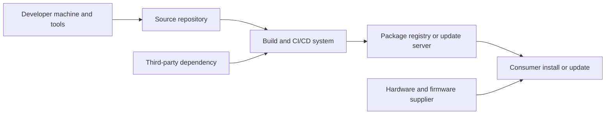

# Supply-chain attacks

## Summary

A supply-chain attack compromises something the victim trusts and installs, instead of attacking the victim directly: a library, a build server, an update channel, a hardware part or a service provider. One successful tampering reaches every customer who consumes the artifact, so the attacker pays once and compromises many. Defenders cannot patch their way out, because the malicious code arrives through the normal update path, signed and expected. This note classifies the attack paths, walks through two documented incidents (SolarWinds Orion and xz), runs three tested checks against common paths and lists the controls that work: pinning with hashes, ownership of names, provenance, build isolation and detection at first run.

## Prerequisites

- [SLSA](../slsa.md) and the [NIST Secure Software Development Framework](../nist-secure-software-development-framework.md), the frameworks that most defenses refer to.
- [Software composition analysis](../../testing/software-composition-analysis.md) for dependency inventories.
- [CVE](../../../../security-operations/vulnerability-management/cve.md) and [CVSS](../../../../security-operations/vulnerability-management/cvss.md), because a supply-chain compromise can receive a CVE.
- [Hashing](../../../../security-architecture-and-engineering/cryptography/hashing/hashing-algorithms.md) and [PKI](../../../../security-architecture-and-engineering/cryptography/public-key-infrastructure.md) for signatures and digests.

## Core concepts

### Definition

MITRE ATT&CK describes *Supply Chain Compromise* (T1195, tactic Initial Access, version 1.7, last modified October 2025) as adversaries manipulating products or their delivery mechanisms before they reach the end user, to compromise data or systems. The manipulation can occur in development tools, development environments, source code repositories, open source dependencies, update and distribution mechanisms, factory-installed system images, counterfeit products or shipment interception. ATT&CK splits it into three sub-techniques: T1195.001 Compromise Software Dependencies and Development Tools, T1195.002 Compromise Software Supply Chain and T1195.003 Compromise Hardware Supply Chain. It also names *second-order* compromises, where access gained in one supply-chain compromise is used to compromise further components and more victims (checked 2026-10).

A supply-chain attack differs from a normal vulnerability. A vulnerability is a flaw the producer did not intend. A supply-chain attack is an intended malicious change, introduced by an outsider or an insider, in something the victim has good reason to trust.

### Analogy

Poisoning a reservoir instead of every house. The attacker does not need to reach each tap. Each consumer's own good habits (drinking tap water, installing updates) deliver the dose. The analogy breaks in two places: reservoirs have regulators and routine tests, while most software pipelines have neither, and a poisoned dependency usually reaches only the consumers that match a condition the attacker chose.

### Why it works

1. **Trust is transitive.** An application with 20 direct dependencies often has hundreds of indirect ones. Each author and each build system in that tree is trusted without review.
2. **Updates are the delivery channel.** Hardening advice says to patch quickly, and a malicious update benefits from that habit.
3. **Signatures prove who, not what.** A valid signature shows that the holder of the key signed the artifact. If the attacker is inside the build system, the signature is valid for a malicious build.
4. **Scale.** One compromise reaches many victims, and the attacker can select the high-value ones afterwards.

### Attack paths



The diagram follows an artifact from author to consumer. An attack can enter at any arrow. The rest of this section lists the common entry points.

| Path | Mechanism | Example |
| --- | --- | --- |
| Compromised build system | Attacker alters the build so the output differs from the source | SolarWinds Orion, below |
| Compromised maintainer or malicious maintainer | A trusted contributor inserts code, or an account is taken over | xz, below |
| Dependency confusion | A package name used internally is published on a public index with a higher version, and the resolver picks it. Described by Alex Birsan in February 2021 (from memory, not re-checked) | Demo 1 in the worked example |
| Typosquatting and namesquatting | A package with a name near a popular one | Demo 2 in the worked example |
| Compromised package account | Stolen credentials publish a malicious version | Common in npm and PyPI incidents, not documented here |
| Malicious update channel | The update server or its signing key is compromised | Any vendor that signs on a compromised system |
| Tampered container image or action | A mutable tag or an unpinned CI action points to new, malicious content | Floating tags such as `latest` |
| Hardware and firmware | Implants, counterfeits, tampered firmware (T1195.003) | See CISSP section 1.11 |
| Source of AI models and data | Poisoned datasets, malicious model files | See [adversarial AI](../../../../security-architecture-and-engineering/ai-security/adversarial-machine-learning/README.md) |

### Case 1: SolarWinds Orion (December 2020)

CISA Emergency Directive 21-01, issued on December 13, 2020, ordered U.S. federal agencies to treat SolarWinds Orion products as compromised, described as exploited by malicious actors who could reach network traffic management systems. The original directive covered Orion versions 2019.4 through 2020.2.1 HF1, and Supplemental Guidance v3 (January 6, 2021) narrowed it to specific builds. CISA called disconnecting or powering down the affected products the "only known mitigation measure currently available". Agencies had to image memory and hosts, look for new accounts, remove attacker accounts and persistence, rebuild monitored hosts from trusted sources and reset credentials used by or stored in Orion. The U.S. government later attributed the activity to Russia's SVR foreign intelligence service (update of April 15, 2021). CISA has since closed the directive. Source: CISA ED 21-01, checked 2026-10.

What the case shows: the defenders did what they were told to do, which was to install a signed vendor update. The hostile code was in the vendor's build output. Detection and response were driven by an external disclosure, and the response required rebuilding trust (new credentials, rebuilt hosts), which is expensive.

### Case 2: xz and liblzma, CVE-2024-3094 (March 2024)

The National Vulnerability Database (published 2024-03-29) describes malicious code in the upstream tarballs of xz starting with version 5.6.0. Through "a series of complex obfuscations", the liblzma build process extracts a prebuilt object file from a disguised test file in the source tree, which modifies functions in liblzma and so can intercept and modify data in any software linked against the library. NVD lists a CVSS 3.1 base score of 10.0 (`AV:N/AC:L/PR:N/UI:N/S:C/C:H/I:H/A:H`) and the weakness CWE-506 (Embedded Malicious Code), as assigned by the CNA (checked 2026-10 through the NVD API).

What the case shows: the malicious code was in the release tarballs and not in a visible form in the repository, a build-time injection that source review alone would miss. Public reporting also described a long social engineering effort against the project maintainer, which I did not verify from a primary source for this note. The discovery came from a developer noticing a small performance difference in a different tool, not from a security product. The lesson for defenders is that dependency trust is trust in people with commit rights, and that reproducible builds and comparing release tarballs with the repository are cheap checks.

### Controls

| Control | What it stops | Notes |
| --- | --- | --- |
| Pin dependencies to exact versions and hashes (lockfiles with digests) | Silent replacement of a version, tampering in transit | Update through reviewed pull requests |
| Owned names resolve only from internal indexes (scoped packages, index priority rules) | Dependency confusion | Reserve your names on public indexes too |
| Allow-list registries and mirror approved packages internally | Typosquats and unknown sources | ATT&CK M1033 Limit Software Installation |
| Build provenance and signed attestations (SLSA) | Unknown build origin, tampered artifacts | SLSA levels describe how hard it is to forge provenance |
| Ephemeral, isolated, hardened build systems with minimal credentials | A persistent implant in the build server | The core lesson of SolarWinds |
| Reproducible builds | Differences between source and binary | Needs deterministic toolchains |
| Software bill of materials (SBOM) and composition analysis | Not knowing what is inside | Inventory, not prevention |
| Least privilege for software and short-lived tokens | Blast radius of a compromised component | ATT&CK M1018 User Account Management |
| Detection at first run: unexpected egress, new child processes, hash and signature mismatches | Compromise that passed the gates | ATT&CK detection DET0537 describes this behavior |
| Supplier risk management | Hardware and service providers | CISSP section 1.11 |

## Worked example

The script `scripts/supply-chain-checks.py` runs three checks on a synthetic package index, with no network access. Python 3.10, standard library only. The output is real.

```bash
python3 scripts/supply-chain-checks.py
```

Output:

```text
1 naive resolver       : ('public', '9.9.9')
1 owned-name resolver  : ('internal', '1.4.2')
2 typosquat check      : 'requets'  -> [('requests', 1)]
2 typosquat check      : 'numpyy'   -> [('numpy', 1)]
2 typosquat check      : 'flask'    -> no near neighbor
3 lockfile hash check  : registry copy -> accepted
3 lockfile hash check  : tampered copy -> REJECTED, hash differs
```

1. **Dependency confusion.** The internal package `acme-utils` is 1.4.2. An attacker published `acme-utils` 9.9.9 on the public index. The naive resolver searches every index and takes the highest version, so it installs the attacker's package. The owned-name resolver sends names that exist internally only to the internal index and selects 1.4.2. The real fix in package managers is index scoping or namespaces, plus reserving the names publicly.
2. **Typosquat detection.** An edit-distance of 1 or 2 from a popular name flags `requets` and `numpyy`. `flask` is not flagged because it is not in the sample list. A check like this belongs in registry-side scanning or in a proxy that gates new package names. It produces false positives for legitimate similar names, so treat it as a review trigger.
3. **Hash pinning.** The lockfile pins the SHA-256 of `mini-math-1.0.tar`. A backdoored rebuild of the same version has a different digest and is rejected. This stops tampering with an already published version and transit attacks. It does not help when the attacker publishes a new malicious version that you then lock intentionally, which is why the lockfile update must be reviewed.

What none of these checks stops: a compromised build system that signs a malicious artifact and records its digest. That case needs provenance, isolated builds and independent rebuilds, see [SLSA](../slsa.md).

## Trade offs and when to use it

**Cost versus coverage.** Pinning and index scoping are cheap and remove the most common opportunistic attacks. Provenance and reproducible builds are expensive and address the targeted ones. A small team starts with pinning, scoped names, registry allow-lists and a short list of trusted publishers. A producer with many downstream customers must also secure its own build, because it is the target in cases like SolarWinds.

**Costs and limits.**

- Pinning slows security updates. Automate pull requests for updates and review the diff of the dependency tree.
- SBOMs describe contents but do not show tampering.
- Signatures prove origin only if the signing key is protected and the signed content is the intended content.
- Detection at the consumer is weak when the malicious code only runs in a specific environment.
- Open source maintainers carry large trust with little support. Funding, review and multiple maintainers are risk controls too.

**Alternatives and companions.** Vendor risk management (contractual security requirements, assessments) covers suppliers of services. Network egress control and runtime monitoring limit what a compromised component can do. Both are companions, not replacements.

## Common mistakes

| Mistake | Effect | Fix |
| --- | --- | --- |
| Treating a valid signature as proof of safety | Malicious build signed by the real key | Add provenance and build isolation |
| Floating versions and `latest` tags | The next pull may be the malicious one | Pin by version and digest |
| One resolver searching every index | Dependency confusion | Scope names to indexes, reserve public names |
| Build credentials shared with developers or long-lived | A phished developer owns the pipeline | Short-lived, scoped tokens |
| Reviewing source only | Release tarballs and build scripts differ from the repo | Compare artifacts with source, review build scripts |
| No inventory | Cannot answer "are we affected" for hours | SBOM and composition analysis |
| No exercise for a compromised supplier | Slow, improvised response | Add a vendor-compromise scenario, see the [cloud incident example](../../../../security-operations/defensive-operations/operations/nist-incident-response/README.md) |

Detection and mitigation for defenders: watch for hash or signature mismatches at install, new outbound destinations right after an update, unexpected child processes of updated software and new accounts created after a vendor update (the CISA directive asked for exactly that review). Mitigation is the control table above; response follows the [NIST incident response lifecycle](../../../../security-operations/defensive-operations/operations/nist-incident-response/README.md) with credential resets and rebuilds from trusted sources.

## Practice

1. Which ATT&CK sub-technique fits a trojanized dependency, and which fits a tampered vendor update?
2. Why did the SolarWinds response require rebuilding hosts and resetting credentials and not just patching?
3. Why would reviewing the xz source repository not necessarily have found CVE-2024-3094?
4. A company has an internal package `corp-auth`. List three controls that stop dependency confusion.
5. Extend `supply-chain-checks.py` so that the typosquat check ignores names that appear in an allow-list file. What new risk does the allow-list create?
6. Which CISSP sections cover this topic?

**Answers and hints**

1. T1195.001 for a dependency or development tool, T1195.002 for the software supply chain, which includes the update mechanism.
2. The malicious code ran inside the monitoring software with its privileges and credentials. Anything that product could reach was exposed, so the trust boundary had to be rebuilt.
3. NVD says the malicious payload was extracted at build time from a disguised test file and present in the release tarballs. Source review needs to cover the build process and the tarball contents.
4. Index scoping or namespaces, reserving the name on public indexes, and hash-pinned lockfiles. A resolver that ignores public indexes for owned names is the same idea.
5. Allow-list entries become a trust decision, so they need an owner and review. A stale entry hides a real squat.
6. Section 1.11 (supply chain risk management), 8.4 (security impact of acquired software), 8.2 (security controls in development ecosystems) and 3.5 (vulnerabilities of architectures). See [CISSP security domains](../../../../security-and-risk-management/reference/certifications/cissp-security-domains.md).

## Further reading

- MITRE ATT&CK, [T1195 Supply Chain Compromise](https://attack.mitre.org/techniques/T1195/): the technique, sub-techniques, mitigations and detection analytics.
- CISA, [Emergency Directive 21-01](https://www.cisa.gov/news-events/directives/ed-21-01-mitigate-solarwinds-orion-code-compromise): the response requirements for the SolarWinds Orion compromise.
- NIST NVD, [CVE-2024-3094](https://nvd.nist.gov/vuln/detail/CVE-2024-3094): the xz and liblzma backdoor record.
- [SLSA](../slsa.md) and the [NIST SSDF](../nist-secure-software-development-framework.md): the framework side of the controls.
- NIST SP 800-161 Rev. 1 (cybersecurity supply chain risk management practices). Cited as the main supply chain risk document; not read for this note.
- Alex Birsan, *Dependency Confusion: How I Hacked Into Apple, Microsoft and Dozens of Other Companies* (2021). Cited from memory, not re-read.
