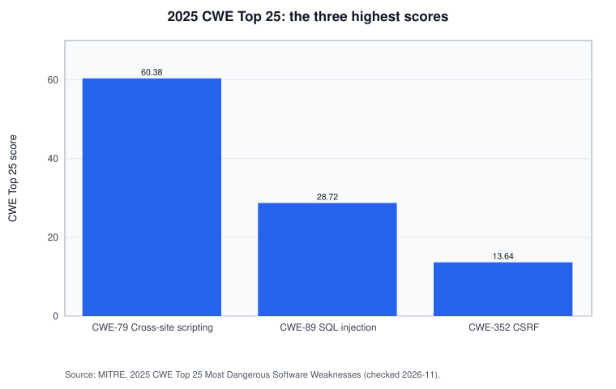
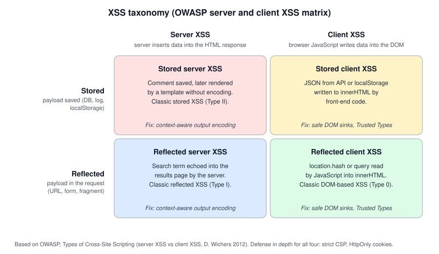
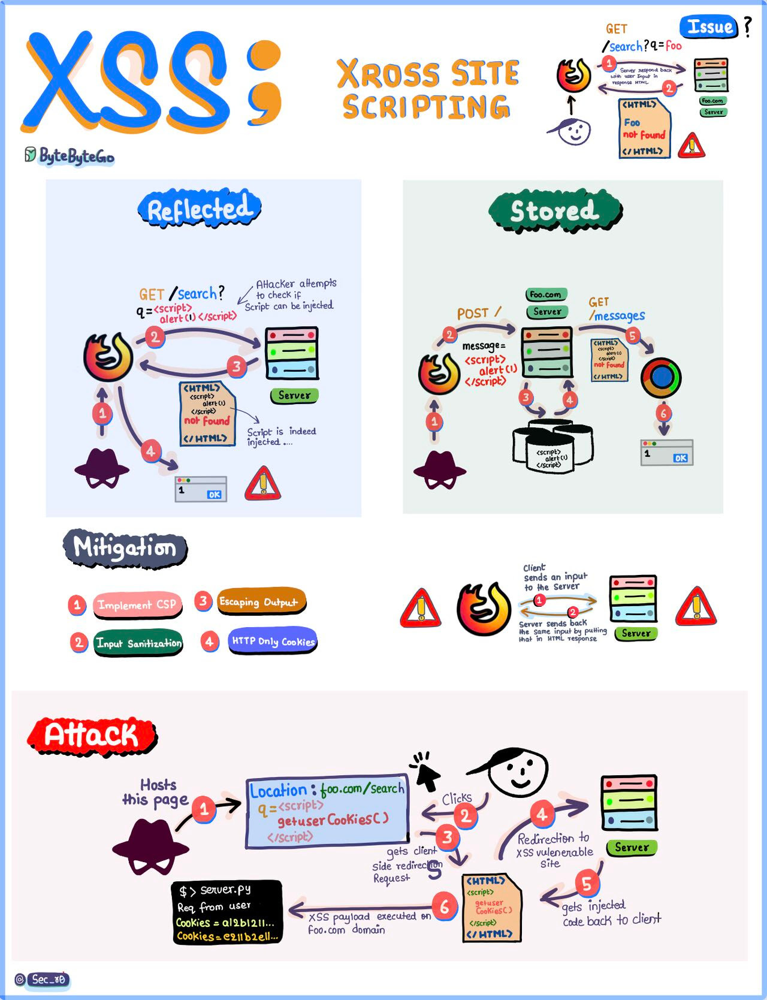
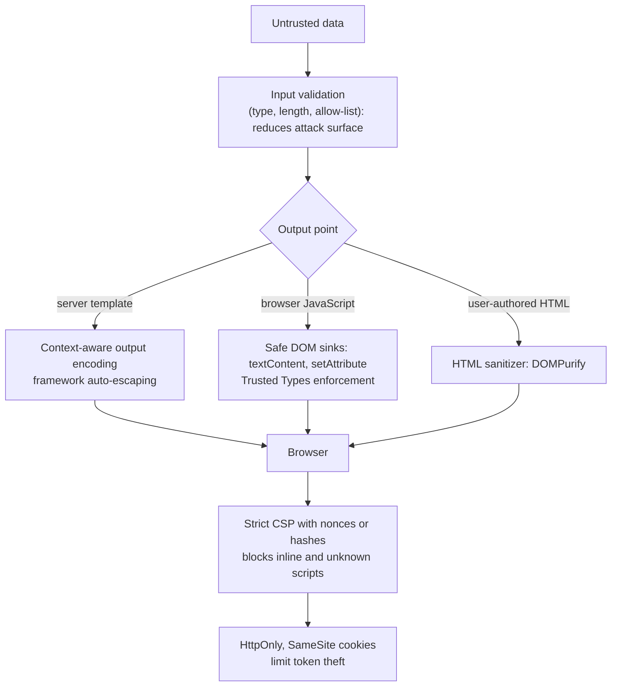

# Cross-site scripting (XSS)

## Summary

Cross-site scripting (XSS) is a web vulnerability in which an application lets attacker-controlled data be interpreted as code in another user's browser. The injected script runs with the full privileges of the vulnerable site in that browser: it can read what the user sees, act as the user, change the page and steal tokens that JavaScript can reach. There are three classic forms, stored, reflected and DOM-based, which differ in where the payload lives and where the unsafe code runs. XSS is CWE-79, ranked number one in the 2025 CWE Top 25. The primary fix is to treat data as data at the point of output (context-aware encoding, safe DOM APIs, framework auto-escaping), with Content Security Policy and Trusted Types as strong second layers. All attack content in this note is for study, labs and authorized testing.

## Prerequisites

- HTML, the DOM and basic JavaScript.
- HTTP requests, responses, cookies and headers.
- The same-origin policy at a basic level: scripts from one origin cannot read data from another origin.
- Helpful: [OWASP Top 10](../../owasp/owasp-top-10.md), where XSS is part of A03:2021 Injection.

## Core concepts

### Definition

MITRE CWE-79, "Improper Neutralization of Input During Web Page Generation ('Cross-site Scripting')", describes the weakness: "The product does not neutralize or incorrectly neutralizes user-controllable input before it is placed in output that is used as a web page that is served to other users."

The essential mechanism is a *context switch*: the browser's parsers (HTML, attribute, JavaScript, CSS, URL) treat certain characters as structure. If data containing `<`, `"` or `'` reaches an HTML or script context without neutralization, the parser leaves the data context and the rest of the input becomes markup or code. The name "cross-site" is historical. Today the defining property is that the attacker's code runs in the victim's browser *in the origin of the vulnerable site*.

XSS is the most dangerous software weakness in MITRE's 2025 CWE Top 25 ranking, which combines how often a weakness appears in published CVEs with their severity:



### Analogy

A newspaper prints readers' letters. The editor copies each letter onto the page exactly as received. One reader writes a letter whose last paragraph is formatted to look like an official notice from the newspaper: "All subscribers must confirm their bank details at the following address." Readers trust the page because the newspaper printed it.

The analogy holds for the core problem: content from one party is presented with the authority of another, because nobody marked where the reader's text ends. It breaks in an important way: a fake notice only persuades people, while injected script acts automatically, with no human decision, using the victim's session.

### The three types and the 2 x 2 view

| Type | Also called | Where the payload is | Who inserts it into the page |
| --- | --- | --- | --- |
| [Stored XSS](stored-xss.md) | Persistent, Type II | Saved by the application (database, file, log) | Usually the server, sometimes client code |
| [Reflected XSS](reflected-xss.md) | Non-persistent, Type I | In the victim's request (URL, form post) | The server, in the immediate response |
| [DOM-based XSS](dom-based-xss.md) | Type 0, client-side | In a browser-controlled source (`location`, `postMessage`, storage) | Client-side JavaScript |

OWASP notes that these types overlap and proposes a cleaner view on two axes: whether the data is stored or reflected, and whether the unsafe insertion happens on the server (server XSS) or in browser JavaScript (client XSS). The terminology goes back to a 2012 AppSec USA talk by Dave Wichers, and the DOM-based XSS concept to Amit Klein (2005), according to OWASP.



The matrix matters for defense: server XSS is fixed with context-aware output encoding on the server, client XSS with safe DOM APIs in JavaScript. A server-side WAF or server-side encoding cannot see a payload that never reaches the server, such as one in a URL fragment.

An older overview infographic, kept for personal study (ByteByteGo):



### What an attacker can do with XSS

Script running in the site's origin can:

- Read the page and the DOM, including personal data, CSRF tokens and anything shown to the user.
- Send authenticated requests as the user with `fetch`, because the browser attaches cookies automatically. This works even with `HttpOnly` cookies.
- Read `localStorage` and `sessionStorage`, where many single-page applications keep access tokens.
- Read cookies without the `HttpOnly` flag (`document.cookie`).
- Change the page: fake login forms, altered payment details, defacement.
- Log keystrokes in the page, and in some cases spread itself (the 2005 MySpace "Samy" worm added over a million friends to its author's profile in about a day; figures from memory, not re-checked).

The impact depends on the victim. XSS in an administrator's view of a support ticket system can lead to full application takeover.

### Defenses in layers



The diagram shows the order of the layers. Encoding and safe sinks fix the root cause. CSP, cookie flags and validation reduce what an attacker can do if one output point is missed. The OWASP XSS Prevention Cheat Sheet calls CSP "an additional layer of defense" and says WAFs "cannot reliably prevent all XSS attacks or fix vulnerable application code".

Output encoding rules by context, summarized from the OWASP XSS Prevention Cheat Sheet (checked 2026-11):

| Context | Example position | Rule |
| --- | --- | --- |
| HTML body | `<p>DATA</p>` | HTML entity encode `& < > " '` |
| Quoted HTML attribute | `<input value="DATA">` | Attribute encode, always quote the value. Not enough for event handler attributes |
| JavaScript string | `<script>var x = "DATA"</script>` | JavaScript encoding inside a quoted string only, never in code or identifiers, never into `eval` |
| URL parameter | `<a href="/s?q=DATA">` | Percent-encode the value, then attribute encode. Validate the scheme of full URLs |
| CSS | `style="color: DATA"` | Do not interpolate into CSS. Use `style.setProperty` with allow-listed values |
| Dangerous contexts | Script body, comments, tag and attribute names, event handlers, `eval`, `setTimeout` with strings | Do not place untrusted data there at all |

## Worked example

The lab in [scripts/run-xss-lab.py](scripts/run-xss-lab.py) is a deliberately vulnerable web server (Python 3.10, standard library only, listens on 127.0.0.1 only). It has one vulnerable and one fixed page for each type, plus a page that keeps the reflected bug but adds a strict CSP, and one that keeps the DOM bug but enforces Trusted Types. [scripts/check-xss-lab.sh](scripts/check-xss-lab.sh) sends the same payload to each page with headless Google Chrome 155 and reports whether it executed. The payload only sets an attribute on `<body>`:

```html

```

```bash
python3 run-xss-lab.py &          # XSS lab on http://127.0.0.1:8088 (local only)
./check-xss-lab.sh
```

Output (Ubuntu 22.04, Chrome 155.0.8059.84, November 2026):

```text
reflected  /search                 EXECUTED
reflected  /search-safe            blocked
reflected  /search-csp             blocked
stored     /comments               EXECUTED
stored     /comments-safe          blocked
DOM-based  /dom#payload            EXECUTED
DOM-based  /dom-safe#payload       blocked
DOM-based  /dom-tt#payload         blocked
```

The last line is the vulnerable DOM page served with Trusted Types enforcement. The three type notes walk through each pair: [stored](stored-xss.md#worked-example), [reflected](reflected-xss.md#worked-example) and [DOM-based](dom-based-xss.md#worked-example). Two lines are worth noting here. `/search-safe` and `/comments-safe` differ from the vulnerable pages only by one call to `html.escape`. `/search-csp` still contains the bug, but Chrome refused to run the inline event handler and logged the reason:

```text
Executing inline event handler violates the following Content Security Policy directive 'script-src 'self''. ... The action has been blocked.
```

CSP turned an exploitable bug into a harmless one in this case. It would not help if the policy allowed `'unsafe-inline'`, or if the attacker could load script from an allowed origin.

## Trade offs and when to use it

| Defense | Strength | Cost and limits |
| --- | --- | --- |
| Framework auto-escaping (React, Angular, Jinja2 autoescape, Razor) | Fixes most server and client XSS by default | Escape hatches (`dangerouslySetInnerHTML`, `bypassSecurityTrustHtml`, `|safe`, `v-html`) reopen the hole |
| Context-aware encoding | Root cause fix for server XSS | Must match the exact context. Wrong context means no protection |
| Safe DOM APIs | Root cause fix for client XSS | Requires refactoring legacy jQuery or `innerHTML` code |
| HTML sanitizer (DOMPurify) | Needed when users may submit rich HTML | Must be kept updated. Modifying output after sanitizing can undo it |
| Strict CSP with nonces or hashes | Blocks most injected scripts even when a bug exists | Needs removal of inline scripts and event handlers. Weak policies give false confidence |
| Trusted Types | Makes DOM XSS sinks refuse plain strings | Baseline across major browsers only since February 2026 according to MDN. Needs policy design |
| `HttpOnly` and `SameSite` cookies | Stops cookie theft through `document.cookie` | Does not stop the script from acting as the user |
| WAF | Blocks known payload patterns quickly | Bypassable, blind to DOM XSS in fragments. A temporary measure, see [web application firewalls](../../../../communication-and-network-security/network-security/traffic-filtering/web-application-firewalls.md) |
| Input validation | Reduces attack surface for structured fields (IDs, dates) | Cannot make free text such as names or comments safe |

Use all root cause fixes everywhere. Use CSP and Trusted Types on any application with sessions or sensitive data. Rely on a WAF only as a temporary shield while code is fixed.

## Common mistakes

- **Sanitizing input instead of encoding output.** Input is used in many contexts later (HTML, JSON, SQL, logs). Fix: store data as received, encode at each output for that output's context.
- **Using HTML encoding in a JavaScript or URL context.** Fix: use the encoder for the exact context, or avoid the context.
- **Trusting `HttpOnly` as an XSS fix.** Fix: it limits one consequence. The script can still use the session.
- **Blacklisting `<script>`.** Payloads use event handlers, SVG, `javascript:` URLs and many encodings. Fix: allow-lists and encoding, not blacklists.
- **CSP with `'unsafe-inline'` or broad host allow-lists.** Fix: nonce or hash based strict CSP with `'strict-dynamic'`, tested with the CSP Evaluator.
- **Forgetting client-side code in reviews.** Server-side scans miss DOM XSS. Fix: review JavaScript sinks, use browser-based DAST, enforce Trusted Types.
- **Escape hatches in frameworks.** Fix: search the code base for them and require sanitization at each one.

## Detection

- **Code review and SAST:** search for raw template output (`|safe`, `{!! !!}`, `<%- %>`), `innerHTML`, `outerHTML`, `document.write`, `insertAdjacentHTML`, `eval`, `dangerouslySetInnerHTML`, `bypassSecurityTrust`, jQuery `.html()`.
- **DAST:** browser-based scanners (for example OWASP ZAP with its DOM XSS add-on, Burp Suite) detect reflected and some stored and DOM XSS.
- **CSP reporting:** a `report-to` or `report-uri` endpoint receives violation reports that often reveal injection attempts and missed inline scripts.
- **Logs:** request patterns containing `<script`, `onerror=`, `javascript:` or encoded variants in parameters. Expect noise from scanners.

## Practice

1. Why does the attacker's script run with the privileges of the vulnerable site and not of the attacker's site?
2. Which type of XSS can a server-side WAF never see, and why?
3. A cookie has `HttpOnly` and `Secure`. What can an XSS payload still do?
4. Where should encoding happen: when data is received or when it is output? Why?
5. In the lab output, why was `/search-csp` blocked even though the page contains the same bug as `/search`?

Answers:

1. Because the browser receives the script inside a page from the vulnerable origin, so the same-origin policy treats it as that site's code.
2. DOM-based XSS with a payload in the URL fragment, because browsers do not send the fragment to the server.
3. Send authenticated requests as the user, read the page and tokens in storage, change the page, show fake forms.
4. At output, because only then is the context (HTML, attribute, JavaScript, URL) known, and the same data may be output in several contexts.
5. The CSP `script-src 'self'` forbids inline event handlers, so Chrome refused to run the `onerror` code.

## Further reading

- [MITRE CWE-79](https://cwe.mitre.org/data/definitions/79.html): the weakness definition and the Type 0, 1 and 2 split. Checked 2026-11.
- [MITRE, 2025 CWE Top 25 Most Dangerous Software Weaknesses](https://cwe.mitre.org/top25/archive/2025/2025_cwe_top25.html): CWE-79 ranked first with a score of 60.38. Checked 2026-11.
- [OWASP Cross Site Scripting Prevention Cheat Sheet](https://cheatsheetseries.owasp.org/cheatsheets/Cross_Site_Scripting_Prevention_Cheat_Sheet.html): output encoding by context, dangerous contexts, frameworks, sanitization and defense in depth. Checked 2026-11.
- [OWASP, Types of Cross-Site Scripting](https://owasp.org/www-community/Types_of_Cross-Site_Scripting): stored, reflected, DOM-based and the server and client XSS matrix. Checked 2026-11.
- [OWASP DOM based XSS Prevention Cheat Sheet](https://cheatsheetseries.owasp.org/cheatsheets/DOM_based_XSS_Prevention_Cheat_Sheet.html): the rules for client-side code.
- [MDN, Trusted Types API](https://developer.mozilla.org/en-US/docs/Web/API/Trusted_Types_API): policies, enforcement through CSP and browser support. Checked 2026-11.
- [MDN, Content Security Policy](https://developer.mozilla.org/en-US/docs/Web/HTTP/Guides/CSP): directives, nonces, hashes and reporting.
