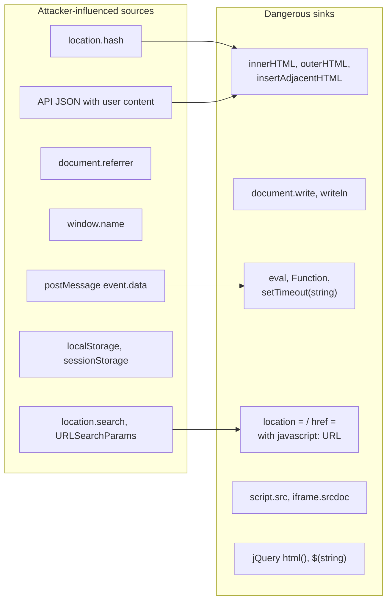
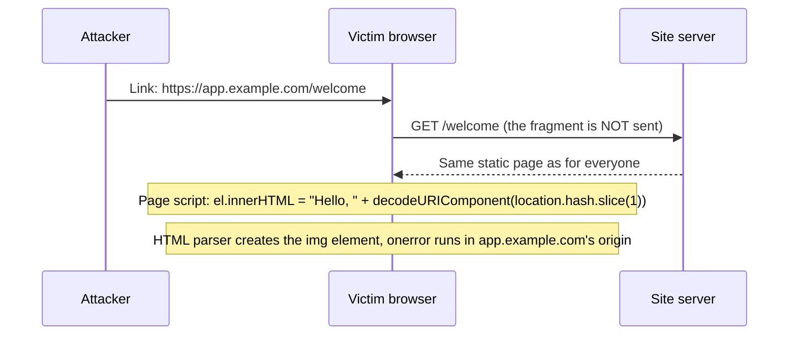

# DOM-based XSS

## Summary

DOM-based XSS (also Type 0 or client-side XSS) happens when the page's own JavaScript takes data from a source the attacker can influence, such as the URL fragment, the query string, `postMessage` or web storage, and passes it to a dangerous sink such as `innerHTML`, `document.write` or `eval`. The server may never see the payload, so server-side encoding, server logs and many WAFs miss it entirely. It grows with single-page applications, which move rendering into the browser. The fix is in the client code: use safe sinks (`textContent`, `setAttribute` with fixed names), sanitize when HTML is truly needed, and enforce Trusted Types so that the browser itself refuses plain strings in dangerous sinks. Offensive content here is for labs and authorized testing.

## Prerequisites

- [Cross-site scripting (XSS)](README.md): definition, impact and the server versus client XSS matrix.
- JavaScript and the DOM API: `document`, `location`, `element.innerHTML`.
- URL parts: the fragment (`#...`) is processed by the browser and not sent to the server (RFC 3986).

## Core concepts

### Definition

OWASP defines DOM-based XSS as an attack "wherein the attack payload is executed as a result of modifying the DOM environment in the victim's browser used by the original client side script, so that the client side code runs in an unexpected manner". The page itself, meaning the HTTP response, does not change. The difference is in what the client code does with attacker-influenced data. OWASP credits Amit Klein with describing the class in 2005. CWE-79 calls it Type 0.

The vocabulary is *sources* and *sinks*:

- A **source** is a JavaScript property or API that returns data an attacker can influence.
- A **sink** is a function or property that interprets data as HTML, script or a URL to navigate to or load.
- A vulnerability exists when data flows from a source to a sink without passing a sanitizer or a safe transformation.



The arrows show four common source to sink flows. The right fix is usually to change the sink, not to encode the data. The OWASP DOM based XSS Prevention Cheat Sheet: "The best way to fix DOM based cross-site scripting is to use the right output method (sink)."

| Dangerous sink | Safe alternative |
| --- | --- |
| `el.innerHTML = data` | `el.textContent = data` |
| `document.write(data)` | Build elements with `createElement` and `textContent` |
| `el.setAttribute(untrustedName, v)` or `el.onclick = data` | `setAttribute` with a constant name, `addEventListener` with a function |
| `eval(data)`, `setTimeout(data)` | `JSON.parse`, functions instead of strings |
| `location.href = data` | Validate against an allow-list of paths or `https:` origins |
| `$(data)` or `$(el).html(data)` in jQuery | `$(el).text(data)` |
| `innerHTML` with intended HTML | `DOMPurify.sanitize(data)` through a Trusted Types policy |

### Analogy

A shop has a well-trained cashier (the server) who checks every banknote. The shop also has a self-service kiosk (the client JavaScript) that reads whatever is written on a sticky note attached to the customer's card and displays it on the big screen as an official announcement. The attacker never talks to the cashier. They give the victim a card with a sticky note.

The analogy fits the key point: server-side controls are not on the path. It breaks in one way: in the real case the victim does not notice the sticky note, because the payload hides in a URL fragment or in a message from another window.

### Mechanism



Browsers percent-encode some characters in the fragment (such as `<`, `>` and `"`), so a sink fed with the raw `location.hash` may only show encoded text. Real code, however, often calls `decodeURIComponent` on it, and other sources (`URLSearchParams.get`, `postMessage`) return decoded data. The lab below uses the decoding pattern because it is common.

### Where DOM XSS hides in modern applications

- **Framework escape hatches:** `dangerouslySetInnerHTML` (React), `bypassSecurityTrustHtml` (Angular), `v-html` (Vue), `unsafeHTML` (Lit).
- **`postMessage` handlers** that do not check `event.origin` and write `event.data` into the DOM.
- **Client-side routing** that renders route parameters into HTML.
- **Third-party scripts and widgets** that read the URL.
- **Client-side template injection**, where an older AngularJS app evaluates `{{...}}` from user data.
- **Stored client XSS:** a backend that safely returns JSON, rendered unsafely by the front end (see [stored XSS](stored-xss.md#definition)).

### Trusted Types

Trusted Types make the browser enforce the "no plain strings in dangerous sinks" rule. With the CSP directive `require-trusted-types-for 'script'`, assigning a string to `innerHTML` and similar sinks throws a `TypeError`. Code must pass a `TrustedHTML` object instead, created by a named policy that typically calls a sanitizer:

```javascript
// Policy defined once, reviewed once. The sink receives TrustedHTML, never a raw string.
const policy = trustedTypes.createPolicy("app-html", {
  createHTML: (input) => DOMPurify.sanitize(input),
});
element.innerHTML = policy.createHTML(userInput);
```

The `trusted-types app-html` directive limits which policy names may be created. MDN marks the Trusted Types API as Baseline 2026, newly available across current major browsers since February 2026 (checked 2026-11). Trusted Types do not sanitize anything by themselves; they force all HTML through the reviewed policy.

## Worked example

The lab in [scripts/run-xss-lab.py](scripts/run-xss-lab.py) serves three versions of a greeting page. `/dom` and `/dom-tt` contain the same vulnerable script:

```html
<div id="greeting"></div>
<script>
  // Vulnerable: attacker-controlled fragment flows into an HTML sink.
  const name = decodeURIComponent(location.hash.slice(1));
  document.getElementById("greeting").innerHTML = "Hello, " + name;
</script>
```

`/dom-safe` changes only the sink to `textContent`. `/dom-tt` keeps the vulnerable code but sends `Content-Security-Policy: require-trusted-types-for 'script'`.

Run with the payload in the fragment, headless Chrome 155 ([scripts/check-xss-lab.sh](scripts/check-xss-lab.sh)):

```text
DOM-based  /dom#payload            EXECUTED
DOM-based  /dom-safe#payload       blocked
DOM-based  /dom-tt#payload         blocked
```

What the browser did on `/dom-safe` (from the dumped DOM): the payload became text.

```text
<div id="greeting">Hello, &lt;img src=x onerror="document.body.dataset.xss=1"&gt;</div>
```

What the browser said on `/dom-tt` (console log):

```text
"This document requires 'TrustedHTML' assignment. The action has been blocked."
"Uncaught TypeError: Failed to set the 'innerHTML' property on 'Element': This document requires 'TrustedHTML' assignment."
```

Trusted Types broke the vulnerable feature (the greeting no longer renders) instead of letting it be exploited. That is the intended behavior: violations show up as errors in testing and in CSP reports, and developers fix them by moving to a safe sink or a policy.

Note that the lab server never received the payload: the fragment is not part of the HTTP request. Server logs for the attack show only `GET /dom`.

## Trade offs and when to use it

| Defense | Benefit | Cost and limits |
| --- | --- | --- |
| Safe sinks (`textContent`, DOM APIs) | Removes the bug class where applied | Refactoring legacy code that builds HTML strings |
| Framework rendering | Auto-escapes by default | Escape hatches must be audited |
| DOMPurify when HTML is required | Allows rich content safely | Library updates, no modification after sanitizing |
| Trusted Types (`require-trusted-types-for 'script'`) | Browser-enforced, catches every missed sink | Third-party libraries that write strings break and need a policy or replacement. Roll out with `Content-Security-Policy-Report-Only` first |
| Strict CSP (nonces or hashes) | Blocks injected inline handlers and scripts | Does not stop `eval` of a string if `'unsafe-eval'` is allowed, and does not stop script-less HTML injection |
| Origin checks for `postMessage` | Closes cross-window sources | Must use exact origin comparison, not `indexOf` or `endsWith` |
| Server-side WAF | Little | The fragment never reaches it |

## Common mistakes

- **Encoding in the wrong layer.** Server-side encoding of a value that client code later decodes and inserts into `innerHTML` does nothing. Fix: fix the client sink.
- **Checking `event.origin` loosely.** `origin.endsWith("example.com")` accepts `evil-example.com`. Fix: compare against an exact allow-list.
- **Using jQuery selectors with untrusted strings.** `$(location.hash)` historically created elements from HTML strings. Fix: use `document.getElementById` or `$(el).text()`.
- **Assuming frameworks make DOM XSS impossible.** Fix: grep for escape hatches and URL-based navigation with user data.
- **Turning on Trusted Types enforcement without a report-only phase.** Fix: deploy `Content-Security-Policy-Report-Only: require-trusted-types-for 'script'`, collect violations, then enforce.

## Detection and mitigation

**Detection.**

- Static analysis of JavaScript for source to sink flows (Semgrep and CodeQL have DOM XSS rules).
- Browser-based DAST: tools that run a real browser and inject into fragments and `postMessage` (for example Burp Suite's DOM Invader or OWASP ZAP's DOM XSS add-on).
- Trusted Types and CSP violation reports: with report-only mode, every unsafe sink assignment in production generates a report.
- Code search for sinks: `innerHTML`, `outerHTML`, `insertAdjacentHTML`, `document.write`, `eval`, `new Function`, `setTimeout(` with a string, `.html(`, `dangerouslySetInnerHTML`, `bypassSecurityTrust`, `v-html`.
- Server logs are of little help for fragment-based payloads.

**Mitigation.**

- Safe sinks and framework rendering by default.
- DOMPurify through a Trusted Types policy wherever HTML must be rendered.
- Enforce Trusted Types and a strict CSP, after a report-only rollout.
- Strict origin checks in every `message` event handler.
- Keep front-end libraries updated, since many DOM XSS bugs live in widgets and old library versions.

## Practice

1. Why do server-side defenses not see a DOM XSS payload in the URL fragment?
2. Name three sources and three sinks.
3. Fix this line: `document.getElementById("msg").innerHTML = new URLSearchParams(location.search).get("m");`
4. What happens on a page with `require-trusted-types-for 'script'` when code assigns a plain string to `innerHTML`?
5. A `message` handler checks `if (e.origin.indexOf("trusted.com") !== -1)`. What is wrong?

Answers:

1. Browsers do not send the fragment in the HTTP request, so the server, its logs and a WAF never receive it.
2. Sources: `location.hash`, `location.search`, `postMessage` data, `document.referrer`, `window.name`, storage. Sinks: `innerHTML`, `document.write`, `eval`, `setTimeout` with a string, `location.href` with `javascript:`, jQuery `html()`.
3. Use a text sink: `document.getElementById("msg").textContent = new URLSearchParams(location.search).get("m");`
4. The browser throws a `TypeError` and does not perform the assignment.
5. Any origin that contains the string, such as `https://trusted.com.evil.example`, passes. Compare `e.origin` exactly against a list of allowed origins.

## Further reading

- [OWASP DOM based XSS Prevention Cheat Sheet](https://cheatsheetseries.owasp.org/cheatsheets/DOM_based_XSS_Prevention_Cheat_Sheet.html): rules for safe sinks and encoding in client code. Checked 2026-11.
- [OWASP, Types of Cross-Site Scripting](https://owasp.org/www-community/Types_of_Cross-Site_Scripting): DOM-based XSS definition and the client XSS concept. Checked 2026-11.
- [MDN, Trusted Types API](https://developer.mozilla.org/en-US/docs/Web/API/Trusted_Types_API): policies, CSP enforcement, default policy and browser support. Checked 2026-11.
- [W3C, Trusted Types specification](https://w3c.github.io/trusted-types/dist/spec/): the normative definition.
- [RFC 3986, URI Generic Syntax, section 3.5](https://www.rfc-editor.org/rfc/rfc3986#section-3.5): the fragment identifier and why it stays on the client.
- Related notes: [cross-site scripting overview](README.md), [stored XSS](stored-xss.md), [reflected XSS](reflected-xss.md).
