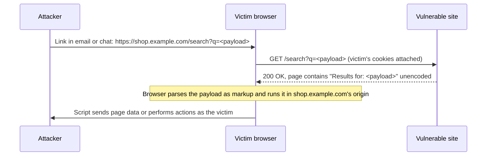

# Reflected XSS

## Summary

Reflected XSS (also non-persistent or Type I XSS) happens when an application takes data from the current request, for example a search term in the URL, and puts it into the immediate response without neutralizing it. The payload is not stored: the attacker must get each victim to send the malicious request, usually by clicking a crafted link in an email, chat message or on another website. Once the victim's browser loads the response, the script runs in the vulnerable site's origin with the victim's session. It is the most common XSS form found by scanners, and it is fixed the same way as stored XSS: context-aware output encoding, framework auto-escaping and a strict Content Security Policy. Offensive content here is for labs and authorized testing.

## Prerequisites

- [Cross-site scripting (XSS)](README.md): definition, impact, the type matrix and defense layers.
- URL structure (path, query string, fragment) and URL encoding.
- Helpful: [phishing](../../../../security-and-risk-management/security-awareness/social-engineering/phishing.md), the usual delivery channel for the malicious link.

## Core concepts

### Definition

OWASP: "Reflected XSS occurs when user input is immediately returned by a web application in an error message, search result, or any other response that includes some or all of the input provided by the user as part of the request, without that data being made safe to render in the browser, and without permanently storing the user provided data." CWE-79 calls it Type 1: the attacker causes the victim to supply dangerous content to the application, which reflects it back.

Typical reflection points: search results ("Results for: ..."), error messages ("User X not found"), form fields re-populated after a validation error, redirect and "return to" parameters, and debugging pages that echo headers.

### Analogy

A receptionist reads aloud, over the building's public address system, whatever is written on the visitor's request slip: "Visitor for Ms. Novak: ...". An attacker hands a stranger a pre-filled slip and asks them to give it to the receptionist. The slip says "Visitor for Ms. Novak. Attention all staff: fire drill, leave your laptops unlocked and exit now." The announcement carries the building's authority, and the stranger delivered it without knowing.

The analogy fits the delivery: the victim carries the payload to the trusted party, which reflects it. It breaks because the reflected script affects only the victim who sent the request, not everyone in the building, which is the main difference from stored XSS.

### Mechanism



The request can also be a POST: the attacker hosts a page with an auto-submitting form that posts the payload to the vulnerable site. `SameSite=Lax` cookies (the default in Chromium-based browsers for cookies without a `SameSite` attribute, from memory) are not sent on cross-site POSTs, which can blunt this variant, but they are sent on top-level GET navigations, so the link variant still works.

### Delivery and why it still works

- **Link obfuscation.** URL shorteners, redirects through trusted sites, or long URLs where the payload is hidden after many parameters.
- **Trusted domain.** The link really points to the legitimate site, so domain-based phishing checks pass. This makes reflected XSS valuable for targeted phishing.
- **Browser defenses were removed.** Chrome removed its built-in XSS Auditor in version 78 (2019) and other browsers dropped similar filters, because they could be bypassed and could be abused to leak information. There is no browser-side filter to rely on today. (Version and year from memory, not re-checked for this note.)

### Contexts determine the payload

The attacker shapes the payload to break out of the exact context where data is reflected. The fix must match the same context.

| Reflection context | Vulnerable code (template) | Payload idea | Correct fix |
| --- | --- | --- | --- |
| HTML body | `<p>Results for: {q}</p>` | `` | HTML encode |
| Quoted attribute | `<input value="{q}">` | `" autofocus onfocus=...` | Attribute encode and quote |
| Unquoted attribute | `<input value={q}>` | ` onmouseover=...` (a space is enough) | Always quote, then attribute encode |
| JavaScript string | `<script>var s = '{q}';</script>` | `';...//` or `</script><script>...` | Avoid. Put data in a `data-` attribute or JSON block and read it with safe APIs |
| URL in `href` | `<a href="{url}">` | `javascript:...` | Validate scheme allow-list (`https:`), then attribute encode |

## Worked example

The lab in [scripts/run-xss-lab.py](scripts/run-xss-lab.py) has three search pages. The code paths differ in one line each:

```python
# /search (vulnerable)
self.send_page("Search", f"<p>Results for: {q}</p>")
# /search-safe (fixed with context-aware encoding for HTML body)
self.send_page("Search", f"<p>Results for: {html.escape(q)}</p>")
# /search-csp (still vulnerable, but served with a strict CSP)
csp = "default-src 'self'; script-src 'self'; object-src 'none'; base-uri 'none'"
self.send_page("Search", f"<p>Results for: {q}</p>", {"Content-Security-Policy": csp})
```

Step 1, observe the reflection with harmless markup (lab running on 127.0.0.1:8088, curl 7.81):

```bash
curl -s "http://127.0.0.1:8088/search?q=%3Cb%3Ehi%3C%2Fb%3E"
curl -s "http://127.0.0.1:8088/search-safe?q=%3Cb%3Ehi%3C%2Fb%3E"
```

```text
<!doctype html><html><head><meta charset='utf-8'><title>Search</title></head><body><p>Results for: <b>hi</b></p></body></html>
<!doctype html><html><head><meta charset='utf-8'><title>Search</title></head><body><p>Results for: &lt;b&gt;hi&lt;/b&gt;</p></body></html>
```

`<b>` survived as a real tag in the first response. That proves HTML injection, and script execution follows.

Step 2, confirm execution in a real browser with [scripts/check-xss-lab.sh](scripts/check-xss-lab.sh) (headless Chrome 155):

```text
reflected  /search                 EXECUTED
reflected  /search-safe            blocked
reflected  /search-csp             blocked
```

Step 3, see why `/search-csp` was blocked. The response header:

```bash
curl -s -D - -o /dev/null "http://127.0.0.1:8088/search-csp?q=x" | grep -i content-security
```

```text
Content-Security-Policy: default-src 'self'; script-src 'self'; object-src 'none'; base-uri 'none'
```

Chrome's console message for the attack URL:

```text
Executing inline event handler violates the following Content Security Policy directive 'script-src 'self''. ... The action has been blocked.
```

The bug is still there. A payload that does not need script, such as injected HTML that draws a fake login form posting to the attacker, would still work under this CSP unless `form-action` is also restricted. CSP limits the damage, encoding removes the cause.

## Trade offs and when to use it

- **Encoding and auto-escaping** fix the root cause for every reflection point. Cost: finding every place where request data is echoed, including error pages and legacy code.
- **Strict CSP** turns most reflected XSS into non-exploitable bugs. Cost: refactoring inline scripts and event handlers, and maintaining nonces. Add `form-action` and `frame-ancestors` to cover script-less injection and framing.
- **Input validation** helps for parameters with a fixed format (an `id` that must be digits, a `sort` that must be `asc` or `desc`). It cannot make a free-text search box safe.
- **WAF rules** stop common payloads fast and are useful as a short-term patch, but they are bypassed by context-specific payloads and encodings. See [web application firewalls](../../../../communication-and-network-security/network-security/traffic-filtering/web-application-firewalls.md).
- **User awareness** reduces clicks on suspicious links, but the link points to the real domain, so training alone is weak protection.

## Common mistakes

- **Fixing only the HTML body context.** Attribute and JavaScript reflections remain. Fix: inventory every reflection and its context.
- **Unquoted attributes.** Encoding `<` and `>` does not help when a space starts a new attribute. Fix: always quote.
- **Echoing data into inline `<script>` blocks.** Fix: put data in `<script type="application/json">` or `data-` attributes and read it with `JSON.parse` or `dataset`.
- **Treating error pages and 404 pages as harmless.** They often echo the path or parameter. Fix: include them in review and scanning.
- **Reporting `alert(1)` as the impact.** Stakeholders underrate it. Fix: demonstrate realistic impact in a lab, such as reading the CSRF token and changing the account email.

## Detection and mitigation

**Detection.**

- DAST scanners inject unique markers and check whether they come back unencoded and in which context.
- Web and WAF logs: parameters containing `<`, `>`, `"` followed by `on...=`, `javascript:`, `<svg`, or their URL-encoded forms. Clusters of such requests from one source indicate scanning or fuzzing.
- CSP violation reports with `blocked-uri` of `inline` on pages that echo request data.
- Phishing reports with links to your own domain that carry long or encoded query strings.

**Mitigation.**

- Auto-escaping templates and context-aware encoding at every reflection point.
- Strict CSP with nonces or hashes, plus `form-action 'self'`, `base-uri 'none'`, `object-src 'none'`.
- `HttpOnly`, `Secure` and `SameSite` cookies.
- Validate and allow-list structured parameters, and validate URL schemes for redirect and link parameters.
- Short-term: virtual patch in the WAF for a known vulnerable parameter while the code fix ships.

## Practice

1. What is the key difference in delivery between reflected and stored XSS?
2. Why does a reflected XSS link pass a "does the domain look legitimate?" check?
3. A value is reflected in `<input value={q}>`. Why is encoding `<` and `>` not enough?
4. In the lab, the CSP blocked the payload. Name one injection that would still work under that CSP.
5. Why can input validation not fully fix reflected XSS in a search box?

Answers:

1. Reflected XSS needs each victim to send the malicious request (usually by clicking a link). Stored XSS fires for anyone who views the stored content.
2. The link points to the real, vulnerable site.
3. The attribute is unquoted, so a space ends the value and the attacker adds a new attribute such as an event handler without using `<` or `>`.
4. Script-less HTML injection, for example a fake login form posting to an external site, because the policy does not restrict `form-action`.
5. A search box must accept arbitrary text, including characters that are special in HTML. Only output encoding makes that text safe.

## Further reading

- [OWASP, Types of Cross-Site Scripting](https://owasp.org/www-community/Types_of_Cross-Site_Scripting): the reflected XSS definition quoted above. Checked 2026-11.
- [OWASP Cross Site Scripting Prevention Cheat Sheet](https://cheatsheetseries.owasp.org/cheatsheets/Cross_Site_Scripting_Prevention_Cheat_Sheet.html): encoding rules per context and dangerous contexts. Checked 2026-11.
- [MITRE CWE-79](https://cwe.mitre.org/data/definitions/79.html): Type 1 description. Checked 2026-11.
- [MDN, Content Security Policy](https://developer.mozilla.org/en-US/docs/Web/HTTP/Guides/CSP): strict CSP, `form-action` and reporting.
- [Google CSP Evaluator](https://csp-evaluator.withgoogle.com/): checks a policy for common bypasses.
- Related notes: [cross-site scripting overview](README.md), [stored XSS](stored-xss.md), [DOM-based XSS](dom-based-xss.md), [phishing](../../../../security-and-risk-management/security-awareness/social-engineering/phishing.md).
