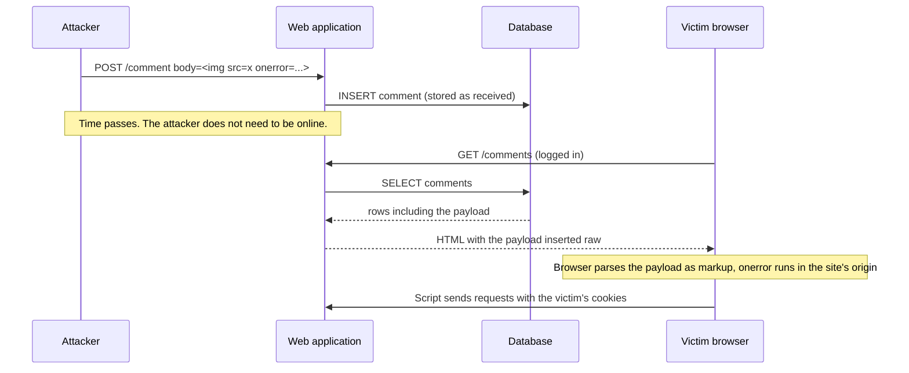

# Stored XSS

## Summary

Stored XSS (also persistent or Type II XSS) happens when an application saves attacker-supplied data, for example a comment, a profile field or a support ticket, and later inserts it into pages for other users without neutralizing it. The payload then runs in every browser that views the page, with no need to trick each victim into clicking a link. That makes it the most dangerous of the three XSS types: one injection can reach many users, including administrators, and can even spread itself. The fix is the same as for all server XSS: context-aware output encoding (or framework auto-escaping) at every place stored data is rendered, plus a strict Content Security Policy. Offensive content here is for labs and authorized testing.

## Prerequisites

- [Cross-site scripting (XSS)](README.md): definition, impact, the type matrix and the defense layers.
- How web applications store and render user content (database, templates).

## Core concepts

### Definition

OWASP describes stored XSS as occurring "when user input is stored on the target server, such as in a database, in a message forum, visitor log, comment field, etc." and later retrieved and included in a page without being made safe. CWE-79 calls it Type 2: the malicious content is saved and runs when other users view it.

In the 2 x 2 view (see the [matrix](README.md#the-three-types-and-the-2-x-2-view)), stored XSS can be:

- **Stored server XSS**: the server template renders the saved value raw. The classic case.
- **Stored client XSS**: the server returns the saved value safely as JSON, but front-end code writes it into `innerHTML`. Server-side encoding does not help here, because the dangerous step is in the browser. See [DOM-based XSS](dom-based-xss.md).

### Analogy

A building has a public notice board in the lobby. Anyone can pin a note, and the building staff photocopy the board every morning into the newsletter that goes into every apartment. One day someone pins a note designed to look like an instruction from management. It now reaches every resident, every day, without the author being present.

The analogy fits persistence and reach. It breaks because a note only persuades readers. A stored XSS payload executes automatically in each reader's browser, using that reader's session.

### Mechanism



Three properties make stored XSS severe:

1. **No user interaction beyond normal browsing.** Victims open a page they trust.
2. **Many victims per injection.** Every viewer runs the payload.
3. **Privileged victims.** Moderators and administrators review user content, so a payload aimed at the admin view (often called *blind XSS*, because the attacker cannot see the page where it fires) can lead to full application takeover.

### Typical injection points

| Stored in | Rendered in | Example |
| --- | --- | --- |
| Comments, forum posts, reviews | Public pages | Classic forum XSS |
| Profile fields (display name, bio, avatar URL) | Every page showing the user | Name shown in a header on every page |
| Support tickets, contact forms, chat | Back-office and admin tools | Blind XSS against support staff |
| File names and metadata (EXIF, PDF title, SVG content) | File lists, previews | SVG with an embedded `<script>` served from the app origin |
| Log entries (User-Agent, Referer) | Log viewers and SIEM web consoles | Payload in a User-Agent header fires when an analyst opens the log |
| Data from other systems (CRM import, webhooks) | Dashboards | "Trusted" internal data that originated from a customer |

The last two rows matter for defenders: security tools themselves render attacker-controlled strings. A log viewer that renders a User-Agent header as HTML is a stored XSS target.

## Worked example

The lab from the [overview](README.md#worked-example), [scripts/run-xss-lab.py](scripts/run-xss-lab.py), stores comments in a Python list and renders them on two pages. The only difference between them:

```python
# /comments (vulnerable): stored value inserted as raw HTML
items = "".join(f"<li>{c}</li>" for c in COMMENTS)

# /comments-safe (fixed): same stored value, HTML-encoded at output time
items = "".join(f"<li>{html.escape(c)}</li>" for c in COMMENTS)
```

Store the payload once, then fetch both pages (Python 3.10, curl 7.81, lab running on 127.0.0.1:8088):

```bash
curl -s -o /dev/null --data-urlencode 'body=' \
     http://127.0.0.1:8088/comment
curl -s http://127.0.0.1:8088/comments
curl -s http://127.0.0.1:8088/comments-safe
```

Output (head elements removed for readability):

```text
<!doctype html><html><body><ul><li></li></ul></body></html>
<!doctype html><html><body><ul><li>&lt;img src=x onerror=&quot;document.body.dataset.xss=1&quot;&gt;</li></ul></body></html>
```

In the first response, the browser sees a real `` element with an `onerror` handler. In the second, it sees text that looks like code. The headless Chrome check in [scripts/check-xss-lab.sh](scripts/check-xss-lab.sh) confirmed it: `stored /comments EXECUTED`, `stored /comments-safe blocked`.

Note that the stored data is identical in both cases. The fix happens at output, not at input. If the application also exported comments to CSV, JSON or a PDF, each export would need its own context-appropriate encoding.

A realistic, harmless proof of concept for an authorized test does not use `alert(1)` in production systems shared with real users. It uses a payload that calls back to a tester-controlled endpoint with a unique ID (for blind XSS), or sets a marker visible only to the tester, and it is removed after the test.

## Trade offs and when to use it

The defense choices are the general XSS ones (see [the overview](README.md#trade-offs-and-when-to-use-it)). Choices specific to stored content:

| Situation | Approach | Notes |
| --- | --- | --- |
| Plain text fields (names, comments without formatting) | Auto-escaping templates, never mark as safe | The default in modern frameworks |
| Users must enter formatting | Markdown rendered by a library configured to drop raw HTML, or a sanitizer such as DOMPurify with an allow-list | Sanitize after rendering, not before, and do not modify output afterwards |
| Users upload SVG or HTML files | Serve from a separate, cookieless domain with `Content-Disposition: attachment` or a sandboxing CSP | An SVG is an XML document that can contain script |
| Data from logs or other systems shown in admin tools | Treat as untrusted, same encoding rules | Internal does not mean trusted |
| Legacy pages that cannot be fixed quickly | Strict CSP and a WAF rule as temporary layers | Track the fix with a deadline |

## Common mistakes

- **Encoding on input and storing the encoded form.** It breaks other outputs (JSON, emails, search) and leads to double encoding or, worse, decoding later. Fix: store raw, encode at output.
- **Trusting data because it came from the database.** Fix: anything a user could ever influence is untrusted at render time.
- **Sanitizing with regular expressions.** HTML parsing is complex and browsers are forgiving. Fix: a maintained sanitizer with an allow-list.
- **Forgetting admin and back-office views.** Fix: include internal tools in code review, scanning and CSP rollout.
- **Fixing the one reported field.** Stored XSS usually reflects a pattern (a template helper that disables escaping). Fix: search for every use of the raw-output construct.

## Detection and mitigation

**Detection.**

- SAST and review: raw output constructs in templates (`|safe`, `{{{ }}}`, `{!! !!}`, `<%- %>`, `Html.Raw`), `dangerouslySetInnerHTML`, `v-html`.
- DAST with stored payload tracking: tools submit unique markers and crawl to find where they appear.
- Database hunting: search stored content for `<script`, `onerror=`, `javascript:`, `<svg` and encoded variants after an incident or before a migration.
- CSP violation reports: inline script violations on pages that render user content often point straight at a stored payload.
- Web logs: POST requests with HTML or event handler syntax in parameters, especially to profile, comment and ticket endpoints.

**Mitigation.**

- Auto-escaping templates everywhere stored content is rendered, with escape hatches reviewed.
- HTML sanitizer for rich text, kept up to date.
- Strict CSP with nonces or hashes and no `'unsafe-inline'`.
- `HttpOnly`, `Secure` and `SameSite` cookies, and no long-lived tokens in `localStorage`.
- Separate origins for user-uploaded files.
- After an incident: remove stored payloads from the database and caches, invalidate sessions of users who viewed affected pages, review admin actions taken during the exposure window.

## Practice

1. Why is stored XSS usually more severe than reflected XSS?
2. What is blind XSS?
3. The server returns comments as JSON with correct escaping, but the page still executes a stored payload. Which XSS category is this, and where is the bug?
4. Why should comments not be HTML-encoded before they are saved?
5. Name two places outside public pages where stored payloads often fire.

Answers:

1. It needs no link or lure per victim, reaches every viewer, and often reaches privileged users.
2. A stored payload that executes in a page the attacker cannot see, typically an admin or support tool, and reports back to the attacker when it fires.
3. Stored client XSS. The bug is in front-end code that writes the JSON value into an HTML sink such as `innerHTML`.
4. Because the correct encoding depends on the output context (HTML, JSON, CSV, email), which is not known at input time, and pre-encoding causes double encoding and broken data.
5. Admin and support consoles, and log viewers or SIEM dashboards that render request headers.

## Further reading

- [OWASP, Types of Cross-Site Scripting](https://owasp.org/www-community/Types_of_Cross-Site_Scripting): definition of stored XSS and the server and client XSS distinction. Checked 2026-11.
- [OWASP Cross Site Scripting Prevention Cheat Sheet](https://cheatsheetseries.owasp.org/cheatsheets/Cross_Site_Scripting_Prevention_Cheat_Sheet.html): output encoding and HTML sanitization guidance. Checked 2026-11.
- [MITRE CWE-79](https://cwe.mitre.org/data/definitions/79.html): Type 2 description. Checked 2026-11.
- [DOMPurify](https://github.com/cure53/DOMPurify): the HTML sanitizer recommended by OWASP for user-authored HTML.
- Related notes: [cross-site scripting overview](README.md), [reflected XSS](reflected-xss.md), [DOM-based XSS](dom-based-xss.md), [defense in depth](../../../../security-architecture-and-engineering/design-principles/defense-in-depth.md).
